# Rice leaf disease classification - group3-starvenus

A guided tour of this repository for the team. It explains what the project does, where everything lives, how to
rerun or inspect any result, and the story of how we got to the final answer. You do not need to read it in order:
the first three sections are for lookup, the long tutorial (section 5) is for understanding.

Every number in this file comes from the files under `Dhan-Shomadhan/_work/results/` at the git tag `results-freeze`
(the working tree is identical to the tag for results). Numbers are written as mean +- standard deviation over the
five train/validation/test splits, with the sample standard deviation (n - 1).

## Contents

- [1. What this project is](#1-what-this-project-is)
- [2. Where is X? (map)](#2-where-is-x-map)
  - [2.1 The big things](#21-the-big-things)
  - [2.2 `Dhan-Shomadhan/_work/` folder by folder](#22-dhan-shomadhan_work-folder-by-folder)
  - [2.3 The dataset folder names and typos](#23-the-dataset-folder-names-and-typos)
  - [2.4 The final fine-tuned model](#24-the-final-fine-tuned-model)
  - [2.5 Which images train which model](#25-which-images-train-which-model)
- [3. I want to... (recipes)](#3-i-want-to-recipes)
  - [3.1 Read the results](#31-read-the-results)
  - [3.2 Trace a number in the report](#32-trace-a-number-in-the-report)
  - [3.3 Classify my own photo](#33-classify-my-own-photo)
  - [3.4 Regenerate all tables and figures](#34-regenerate-all-tables-and-figures)
  - [3.5 Reproduce the recommended model quickly](#35-reproduce-the-recommended-model-quickly)
  - [3.6 Reproduce everything](#36-reproduce-everything)
  - [3.7 Check my installation](#37-check-my-installation)
  - [3.8 Run it for a different dataset root](#38-run-it-for-a-different-dataset-root)
  - [3.9 Run on Colab or Kaggle (GPU)](#39-run-on-colab-or-kaggle-gpu)
  - [3.10 See what changed since the freeze](#310-see-what-changed-since-the-freeze)
- [4. Setup](#4-setup)
  - [4.1 What you need](#41-what-you-need)
  - [4.2 Mac](#42-mac)
  - [4.3 Pinned packages (all platforms)](#43-pinned-packages-all-platforms)
  - [4.4 Windows](#44-windows)
  - [4.5 Colab](#45-colab)
  - [4.6 Download the pretrained weights, then smoke test](#46-download-the-pretrained-weights-then-smoke-test)
- [5. The tutorial: the project story, chapter by chapter](#5-the-tutorial-the-project-story-chapter-by-chapter)
  - [5.1 The big picture](#51-the-big-picture)
  - [5.2 Chapter 1: the data and its challenges](#52-chapter-1-the-data-and-its-challenges)
  - [5.3 Chapter 2: splits and leakage](#53-chapter-2-splits-and-leakage)
  - [5.4 Chapter 3: the classifier](#54-chapter-3-the-classifier)
  - [5.5 Chapter 4: experiment IDs](#55-chapter-4-experiment-ids)
  - [5.6 Chapter 5: decision gates](#56-chapter-5-decision-gates)
  - [5.7 Chapter 6: domain transfer - the real finding](#57-chapter-6-domain-transfer---the-real-finding)
  - [5.8 Chapter 7: Method A, pasting white leaves onto field photos](#58-chapter-7-method-a-pasting-white-leaves-onto-field-photos)
  - [5.9 Chapter 8: Method B, segment then crop, and why it was cut](#59-chapter-8-method-b-segment-then-crop-and-why-it-was-cut)
  - [5.10 Chapter 9: the final results](#510-chapter-9-the-final-results)
  - [5.11 Chapter 10: success, failure and challenging cases](#511-chapter-10-success-failure-and-challenging-cases)
  - [5.12 Chapter 11: Grad-CAM and the shortcut check](#512-chapter-11-grad-cam-and-the-shortcut-check)
  - [5.13 Chapter 12: limitations and how the method could be improved](#513-chapter-12-limitations-and-how-the-method-could-be-improved)
- [6. Decision history, dead ends and lessons](#6-decision-history-dead-ends-and-lessons)
  - [6.1 Timeline of the key decisions](#61-timeline-of-the-key-decisions)
  - [6.2 What did not work, and what we learned](#62-what-did-not-work-and-what-we-learned)
- [7. Evidence map](#7-evidence-map)
  - [7.1 Report sections, tables and figures](#71-report-sections-tables-and-figures)
  - [7.2 Worked example: 0.675 +- 0.072](#72-worked-example-0675---0072)
- [8. Code map (read-only)](#8-code-map-read-only)
  - [8.1 Notebooks and the generated `.py`](#81-notebooks-and-the-generated-py)
  - [8.2 The commands](#82-the-commands)
  - [8.3 The `reproduce` chain](#83-the-reproduce-chain)
- [9. Glossary](#9-glossary)

---

## 1. What this project is

**The client problem.** A client wants a tool that looks at one photo of a rice leaf and names the disease. There are
five diseases (Brown Spot, Leaf Scald, Rice Blast, Rice Tungro, Sheath Blight). The photo may be taken on a plain
white sheet or out in the field. In computer-vision terms this is five-class image classification, with one twist:
the photos come from two very different **domains**. A white-background photo shows one isolated leaf. A field photo
shows dense rice plants, soil, water and many overlapping leaves, and the sick leaf is a small part of the picture.

**The data.** The public Dhan-Shomadhan dataset has 1106 photos: 769 on white background and 337 in the field
(139 to 283 per class). Our research question is: *can what a model learns from the easy white photos transfer to the
hard field photos, and does explicitly finding the leaf help?*

**What we recommend.** One unified classifier, a Swin-T (a small vision transformer, 27.5 M parameters) that starts
from ImageNet weights and is fine-tuned on white and field photos together. Experiment ID: **E2-swin-U**. It needs
one forward pass and no leaf masks. Two more ambitious ideas were tested and did not beat it: pasting white leaves
onto field photos (Method A) gave no gain, and finding the leaf first (Method B) was cut because the segmenter could
not find leaves in real field photos. The most important finding is not the winner, it is the transfer result:
a model trained on white photos only collapses on the field, and that gap is what the project is about.

**Headline test results of E2-swin-U** (mean +- std over 5 splits, macro-F1 and accuracy):

| Scenario | What is tested | Macro-F1 | Accuracy (%) |
|---|---|---|---|
| (a) white | white-background test photos | 0.798 +- 0.053 | 82.7 +- 4.9 |
| (b) field | field test photos | 0.675 +- 0.072 | 67.6 +- 6.0 |
| (c) mixed | all test photos (about 70% white) | 0.763 +- 0.033 | 78.3 +- 3.6 |

Honest caveat that you will see again later: ResNet50 and ConvNeXt-T score within one standard deviation of Swin-T on
the test set, so the three backbones are statistically tied. Swin-T was chosen by a rule applied to validation data,
not because it won on test (chapter 5.6).

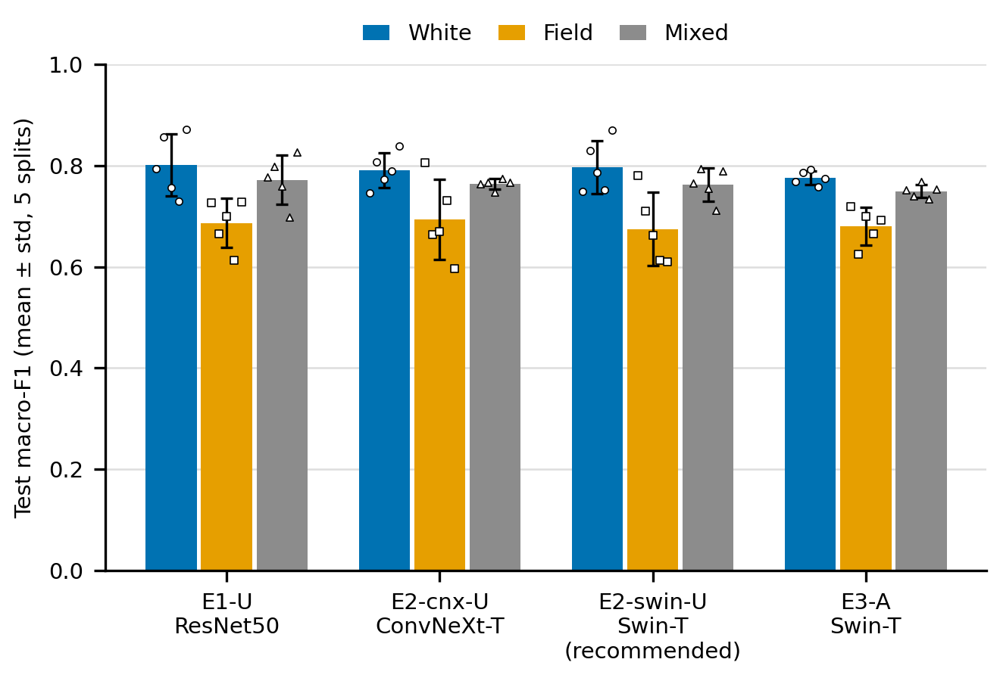

*Figure 1. Macro-F1 on the test split for white, field and mixed photos. Field is always the lowest. File:
`Dhan-Shomadhan/_work/figures/scenario_bars.png`.*

---

## 2. Where is X? (map)

### 2.1 The big things

| I am looking for | Where it is | Notes |
|---|---|---|
| **The report** | Not in git. The editable version is in the group's shared drive: `[shared drive link]`. The submitted PDF is the final version. | Section and table numbers of the report are mapped to files in [section 7](#7-evidence-map). |
| **The deliverable program** | [`group3-starvenus.py`](group3-starvenus.py) | One Python file with every command. **Generated** from the notebooks by `tools/export_py.py`. Never edit it by hand (see [section 8](#8-code-map-read-only)). |
| **The source of that program** | [`notebooks/`](notebooks/) | `10_data`, `20_classifier`, `30_copy_paste`, `40_segmentation`, `50_analysis`, `90_cli`. `runner.ipynb` and `00_dataset_audit.ipynb` are not exported. |
| **The original dataset** | `Dhan-Shomadhan/White Background /` and `Dhan-Shomadhan/Field Background  /` (note the trailing spaces, two after "Background" for field), plus [`Dhan-Shomadhan/Dhan-Shomadhan_picture_Information.csv`](Dhan-Shomadhan/Dhan-Shomadhan_picture_Information.csv) | The images are committed in git, unmodified. Folder names contain typos (see [2.3](#23-the-dataset-folder-names-and-typos)). The code never relies on folder names. |
| **Everything the code generates** | `Dhan-Shomadhan/_work/` | Folder by folder in [2.2](#22-dhan-shomadhan_work-folder-by-folder). |
| **The frozen decisions** | [`Dhan-Shomadhan/_work/results/choices.json`](Dhan-Shomadhan/_work/results/choices.json), also embedded in the `.py` as `FROZEN_CHOICES` | Input mode, learning rates, backbone, composites per epoch, recommended method, each with the validation numbers that justified it. |
| **The freeze** | git tag `results-freeze` (commit `9d38f5c`) | Report numbers come only from this tag. See [3.10](#310-see-what-changed-since-the-freeze). |
| **The final fine-tuned model** | E2-swin-U, one checkpoint `best.pt` per split, `Dhan-Shomadhan/_work/runs/E2-swin-U/split_k/best.pt` | **Not in git** (about 110 MB each, `*.pt` is git-ignored). See [2.4](#24-the-final-fine-tuned-model). |
| **The planning documents** | [`docs/instructions/`](docs/instructions/README.md) | Decisions D1-D13, post-hoc decisions P1-P9, experiment matrix, one file per phase. |
| **Which images train which model** | [`Dhan-Shomadhan/_work/splits/split_0.json`](Dhan-Shomadhan/_work/splits/split_0.json) ... `split_4.json` | Each file lists the `train`, `val` and `test` filenames of one split. See [2.5](#25-which-images-train-which-model). |
| **Per-experiment results** | `Dhan-Shomadhan/_work/runs/<EXP>/split_k/` | `metrics.json` and predictions of every run. |
| **Tables and figures of the report** | `Dhan-Shomadhan/_work/results/table_*.md` and `Dhan-Shomadhan/_work/figures/*.png` | Written by `summarize`. |
| **A narrative summary of the findings** | [`Dhan-Shomadhan/_work/results/findings.md`](Dhan-Shomadhan/_work/results/findings.md) | Part generated, part hand-written. |
| **The Kaggle/Colab runner guide** | [`docs/instructions/kaggle-guide.md`](docs/instructions/kaggle-guide.md) | Step by step. This README does not repeat it. |
| **Unit tests** | [`tests/`](tests/) | `python -m pytest -q`. 576 tests passed at the freeze. |

Other top-level files, one line each: `requirements.txt` (pinned runtime packages), `requirements-dev.txt` (adds
Jupyter, pytest, pandas, labelme), `tools/` (the one-off near-duplicate audit `tools/dup_audit/`, the labelme
converter and the notebook exporter `tools/export_py.py`), `annotations/` (hand-made inputs that get embedded in the
`.py`), `research-diary.md` (early literature notes) and `implementation-plan.md` (the first draft plan), `docs/env/`
(`pip freeze` of the Colab and Kaggle machines the results came from).

### 2.2 `Dhan-Shomadhan/_work/` folder by folder

Everything the program creates lives under `Dhan-Shomadhan/_work/`. Some of it is committed so results are versioned;
some is large and is rebuilt by `prepare` (or `download-weights`) on any machine.

| Folder or file | What is inside | In git? | Rebuilt by |
|---|---|---|---|
| `index.json` | One record per photo: filename, class, domain, EXIF orientation, hash | yes | `prepare` |
| `cache/` | Every photo decoded, rotated upright, shrunk to 1280 px long side (about 200 MB) | no | `prepare` |
| `splits/` | `split_0.json` ... `split_4.json`: train/val/test filenames and a fingerprint | yes | `prepare` (identical on every machine) |
| `masks/` | Automatic leaf masks ("pseudo-masks") of the white photos | no | `prepare` |
| `annotations/` | `selection.json` (which 30 field photos were hand-annotated, tracked); `images/` (copies of those 30 cached photos, not tracked) | `selection.json` only | `prepare` |
| `runs/` | One folder per experiment, then one per split: configs, histories, metrics, predictions | yes, except `*.pt` checkpoints and `runs/scratch/` | `run` / `reproduce` |
| `runs/sweep/` | The learning-rate and composite-count sweeps on split 0. Never reported as results | yes | `run --sweep-lr`, `run --sweep-composites` |
| `runs/retrain/` | Retrained copies of E2-swin-U and E3-A that kept `best.pt`, used for Grad-CAM. Never reported as results | metrics and predictions yes, `*.pt` no | the `batch5-checkpoints` batch of the runner |
| `results/` | Tables (`table_*.md` and `.csv`), `findings.md`, `choices.json`, `cases.csv`, counts, benchmark | yes | `summarize`, `gradcam`, `benchmark`, `prepare`, gates |
| `figures/` | 17 report figures are tracked. Large contact sheets (near-duplicates, mask QC, realism check, annotation overview) are not | partly | `prepare`, `summarize`, `gradcam` |
| `weights/` | The four torchvision pretrained weight files (about 340 MB) | no | `download-weights` |
| `dup_audit/` | Intermediates of the one-off duplicate audit | no | `tools/dup_audit/` |

Outside `_work/`, the folder [`annotations/`](annotations/) holds three small hand-made inputs that are **embedded in
the `.py`** so the program is self-contained: `duplicate_groups.json` (36 groups of near-duplicate photos),
`white_rejects.json` (33 white photos whose automatic leaf mask was rejected by eye) and `field_salient_leaf.json`
(30 hand-drawn leaf outlines on field photos). `annotations/labelme/` has the raw outline files.

### 2.3 The dataset folder names and typos

The original download has typos and trailing spaces. We keep it exactly like that, so the code must never depend on
folder names. Labels come from the **filename prefix** and are cross-checked against the CSV.

| Folder on disk (shown with quotes so spaces are visible) | Photos | Prefix | Class |
|---|---|---|---|
| `'White Background /Brown Spot'` | 90 | `bs_wb_` | Brown Spot |
| `'White Background /Leaf Scaled'` | 143 | `ls_wb_` | Leaf Scald |
| `'White Background /Rice Blast'` | 198 | `rb_wb_` | Rice Blast |
| `'White Background /Rice Tungro'` | 119 | `rt_wb_` | Rice Tungro |
| `'White Background /Shath Blight'` | 219 | `sb_wb_` | Sheath Blight |
| `'Field Background  /Browon Spot'` | 49 | `bsf_` | Brown Spot |
| `'Field Background  /Leaf Scaled'` | 74 | `lsf_` | Leaf Scald |
| `'Field Background  /Rice Blast'` | 74 | `rbf_` | Rice Blast |
| `'Field Background  /Rice Turgro'` | 76 | `rtf_` | Rice Tungro |
| `'Field Background  /Sheath Blight'` | 64 | `sbf_` | Sheath Blight |

Class index order used in every confusion matrix: 0 Brown Spot, 1 Leaf Scald, 2 Rice Blast, 3 Rice Tungro,
4 Sheath Blight. The full tree is in [`docs/instructions/dataset-tree.txt`](docs/instructions/dataset-tree.txt).

### 2.4 The final fine-tuned model

The recommended model is **E2-swin-U**: a Swin-T trained on white + field photos, input 448 x 224, learning rate
3e-4. "The model" is really **five models**, one per split (split 0 to 4), because every experiment is repeated on
five different train/val/test splits. Each has one checkpoint file, `best.pt` (the weights of the epoch with the best
validation macro-F1).

What is in git and what is not:

- In git: for every split, `Dhan-Shomadhan/_work/runs/E2-swin-U/split_k/` holds `config.json`, `env.json`,
  `history.csv`, `metrics.json`, `predictions_val.csv` and `predictions_test.csv`. Everything in the report was
  computed from these.
- **Not in git**: `best.pt`. Checkpoints are git-ignored (`*.pt`).
- The reported runs themselves did not keep `best.pt`. Nattan retrained E2-swin-U (and Method A, E3-A) once on
  Kaggle just to keep the checkpoints. Those copies are in `Dhan-Shomadhan/_work/runs/retrain/E2-swin-U/split_k/best.pt`
  on Nattan's laptop, and their predictions are byte-identical to the reported runs on all 10 splits, so they are
  the reported models. For a teammate the checkpoint can come from three places:
  1. Ask Nattan for the files: `[shared drive link to the checkpoints]`. Put one at
     `Dhan-Shomadhan/_work/runs/E2-swin-U/split_0/best.pt` and `predict` finds it by default.
  2. Retrain split 0 with the command in [3.5](#35-reproduce-the-recommended-model-quickly) (about 6 minutes of
     training on a T4 GPU, 345 s measured for the reported split 0).
  3. Retrain all five splits with `reproduce --recommended` (about 40 minutes on a T4).

`predict` uses **split 0** by default (`--split k` picks another). Any one of the five is a valid "final model";
their test scores differ a little because each split has different test photos (that variation is the std you see
everywhere).

### 2.5 Which images train which model

Training data is decided by two things: the split file and the experiment's **train domains**.

- `Dhan-Shomadhan/_work/splits/split_k.json` lists which photos are `train`, `val` and `test` for split `k`
  (seed `k`). Split sizes are 773-780 train, 163-171 val, 162-165 test (47-49 of the test photos are field). Split 0:
  778 / 166 / 162, with 115 white + 47 field test photos.
- Experiment on split `k` trains only on the `train` list of split `k`, filtered by domain: **U** uses white and
  field, **W** (white only) and **F** (field only) use one domain. Validation photos choose the checkpoint, test
  photos are touched once at the end.
- Method A (composites) adds synthetic images made only from **train** photos of split `k`.
- The 30 hand-annotated field photos are never used as composite backgrounds (see [chapter 5.8](#58-chapter-7-method-a-pasting-white-leaves-onto-field-photos)).

To see the lists for yourself, open `split_0.json` (keys: `seed`, `train`, `val`, `test`, `sha256`).

---

## 3. I want to... (recipes)

Conventions for every command below.

- Run commands from the repository root (the folder that contains `group3-starvenus.py` and `Dhan-Shomadhan/`).
- `python` means the Python of the virtual environment from [section 4](#4-setup) (Python 3.12). On a Mac you can also
  write `.venv/bin/python`.
- Commands never need the `--data-root` flag unless your dataset is elsewhere (default: `Dhan-Shomadhan`).
- **Work in a throwaway copy** when you run anything that writes (`prepare`, `summarize`, `run`). Those commands write
  into the tracked `Dhan-Shomadhan/_work/` folders. If you run them in your normal clone, check `git status` afterwards
  and do not commit the changes.
- Times are measured on a Kaggle/Colab T4 GPU unless said otherwise (source: `table_runtime.md`, user manual of the
  report). CPU training times were not measured; see [3.9](#39-run-on-colab-or-kaggle-gpu).

### 3.1 Read the results

No installation needed. Open these in this order:

1. [`Dhan-Shomadhan/_work/results/findings.md`](Dhan-Shomadhan/_work/results/findings.md) - the narrative with numbers.
2. [`table_required.md`](Dhan-Shomadhan/_work/results/table_required.md) - scenarios white / field / mixed.
3. [`table_domains.md`](Dhan-Shomadhan/_work/results/table_domains.md), [`table_methods.md`](Dhan-Shomadhan/_work/results/table_methods.md),
   [`table_input_mode.md`](Dhan-Shomadhan/_work/results/table_input_mode.md) - the transfer, method and input-size stories.
4. [`Dhan-Shomadhan/_work/figures/`](Dhan-Shomadhan/_work/figures/) - the PNGs.

The `.md` tables are what GitHub renders; the `.csv` twins are what you paste into a spreadsheet.

### 3.2 Trace a number in the report

1. Find the number's table or figure in [section 7](#7-evidence-map) (evidence map). It names the file.
2. Open that file under `Dhan-Shomadhan/_work/results/`.
3. To go one level deeper, open the `metrics.json` of each split under `Dhan-Shomadhan/_work/runs/<EXP>/split_k/` and
   recompute the mean and std. [Section 7.2](#72-worked-example-0675---0072) does this once, with the real values.

### 3.3 Classify my own photo

You need a checkpoint (see [2.4](#24-the-final-fine-tuned-model)) and the setup of [section 4](#4-setup).

```bash
python group3-starvenus.py predict --image path/to/my_leaf.jpg
```

- Default model: the recommended E2-swin-U, split 0, read from `Dhan-Shomadhan/_work/runs/E2-swin-U/split_0/best.pt`.
- If your checkpoint is somewhere else: add `--run-dir path/to/folder_that_contains_best.pt`.
- Another split: `--split 3`. Another experiment: `--exp E3-A` (needs its own checkpoint).
- Output: the five classes with probabilities. Time: well under a second per photo on a laptop CPU (the model forward
  pass measured 78 ms on an 8-core Mac CPU).
- Any JPEG works, portrait or landscape. EXIF rotation is handled the same way as in training.

Reading the output: the model always answers with one of the five diseases, even for a healthy leaf or a non-leaf
photo. Treat a flat distribution (for example 0.3 / 0.3 / 0.2 / ...) as "not sure".

### 3.4 Regenerate all tables and figures

This recomputes every table in `Dhan-Shomadhan/_work/results/` and every figure in `Dhan-Shomadhan/_work/figures/`
from the committed run folders. It trains nothing and loads no checkpoint.

```bash
python group3-starvenus.py download-weights   # only needed once, about 340 MB
python group3-starvenus.py prepare            # once, rebuilds cache/ (the case sheets need the cached photos)
python group3-starvenus.py summarize          # about 10 seconds
```

Where the output lands: `Dhan-Shomadhan/_work/results/table_*.md|csv`, `findings.md` (only the parts between
`<!-- auto:... -->` markers are rewritten), `cases.csv`, and the figures `confusion_*`, `scenario_bars`, `domain_gap`,
`training_curves_*`, `cases_*`. Afterwards run `git diff --stat Dhan-Shomadhan/_work/results`: an empty diff means you
reproduced the committed tables exactly. If it is not empty, tell Nattan.

The Grad-CAM table and figures are separate (`gradcam`, [3.6](#36-reproduce-everything)) because they need checkpoints.

### 3.5 Reproduce the recommended model quickly

On a GPU machine (Kaggle or Colab T4), from a **clean folder** that has the original images but no `_work/`:

```bash
python group3-starvenus.py reproduce --recommended            # about 40 min on one T4, plus the one-off prepare
python group3-starvenus.py reproduce --recommended --splits 0 # split 0 only, about 8 minutes of training
```

What it does, in order: `download-weights`, `prepare`, `run --exp E2-swin-U`, `summarize`. It is resumable: if the
session dies, run the same command again and finished splits are skipped. The frozen decisions (learning rate and so
on) are embedded in the `.py`, so the result is the reported configuration.

Important detail: a run is **skipped when its `metrics.json` already exists and is current**. In this repository the
committed run folders already have `metrics.json`, so running `reproduce --recommended` inside a normal clone prints
`skipped` for every split and retrains nothing. That is by design (it makes runs resumable) but it surprises people. Two ways to actually retrain:

- Use a clean folder (what a fresh Kaggle or Colab session is), or
- Write to a different place without touching the tracked results:

```bash
python group3-starvenus.py run --exp E2-swin-U --splits 0 --out-dir my_checkpoints
# writes my_checkpoints/E2-swin-U/split_0/ including best.pt
python group3-starvenus.py predict --image leaf.jpg --run-dir my_checkpoints/E2-swin-U/split_0
```

Do not use `--force` in your normal clone: it overwrites the committed run folders. GPU numerics are not perfectly
deterministic, so a retrain on another machine can differ in the third decimal of macro-F1.

### 3.6 Reproduce everything

```bash
python group3-starvenus.py reproduce          # about 10 hours on one T4, 20 numbered steps, resumable
```

The 20 steps are listed in [section 8.3](#83-the-reproduce-chain). In a clean folder it retrains every reported
experiment on 5 splits, recomputes the decisions (learning rates, input mode, backbone, composites, recommended
method) and checks them against the frozen ones. If a decision would come out differently (possible from GPU
noise), it prints a warning and keeps the frozen one, so your tables still match the reported ones. At the end it
writes every table and figure.

Individual steps are also commands: for example `python group3-starvenus.py run --exp E2-swin-U`,
`python group3-starvenus.py gate g1`, `python group3-starvenus.py gradcam`.

### 3.7 Check my installation

```bash
python group3-starvenus.py --help     # the command list prints, no data needed
python group3-starvenus.py smoke      # tiny end-to-end run on CPU, about 3 minutes
```

`smoke` runs every code path (data, composites, segmenter, classifier, summarize, predict) on about 20 images for
one epoch, in a temporary folder. It does not change your `_work/` results. If it ends with `OK`, your
Python and package versions are fine. To also run the unit tests (needs `requirements-dev.txt`):
`python -m pytest -q`.

### 3.8 Run it for a different dataset root

If your copy of the images is not at `Dhan-Shomadhan/`, add `--data-root path/to/Dhan-Shomadhan` to any command.
The expected layout is the original one: both background folders and the CSV inside that folder.

### 3.9 Run on Colab or Kaggle (GPU)

Why: Swin-T on a CPU laptop is slow (training on CPU was never timed; the Mac's GPU took 24 to 42 minutes for one
ResNet50 run, and a T4 does a Swin-T run in about 6 to 8 minutes). Use a GPU for anything that trains.

- Kaggle (recommended, about 30 free GPU hours per week, runs in the background): follow
  [`docs/instructions/kaggle-guide.md`](docs/instructions/kaggle-guide.md) from section 1. In short: upload the dataset zip and
  the code as two private Kaggle Datasets, import `notebooks/runner.ipynb`, choose GPU T4 x2 and Internet On, set
  `BATCHES_TO_RUN`, press Save and Run All.
- Colab: the same notebook runs there (the platform is detected). See the "Colab" section at the end of the guide.
- Without the runner notebook: in a GPU session, upload the `.py` and the dataset, `pip install` the pinned packages
  (section 4.3) and run `python group3-starvenus.py reproduce --recommended`.

The runner's internals are not explained here on purpose; the guide has them.

### 3.10 See what changed since the freeze

```bash
git tag -n                                              # shows results-freeze and its message
git log results-freeze..HEAD --oneline                  # commits after the freeze
git diff --stat results-freeze HEAD -- Dhan-Shomadhan   # empty = no result file changed
git diff --stat results-freeze HEAD                     # everything that changed (code, tests, docs)
```

At the time this README was written, the second diff is empty: after the freeze only the program (reproduce
command, frozen decisions embedded), tests and docs changed, not a single result file.

---

## 4. Setup

You only need this to run commands. Reading results and figures needs nothing but a browser.

### 4.1 What you need

- Python **3.12** (the reported experiments ran on Python 3.13 on Colab and Kaggle with the same package versions;
  3.12 is the version the program is documented for).
- The repository with the original images in `Dhan-Shomadhan/` (they are in git).
- For training: a CUDA GPU. For `predict`, `smoke`, `summarize`: any laptop CPU is fine.

### 4.2 Mac

```bash
python3.12 -m venv .venv
source .venv/bin/activate
```

On Apple silicon, torch can use the laptop GPU (`--device mps`); `--device auto` picks CUDA, then MPS, then CPU.

### 4.3 Pinned packages (all platforms)

The same four `pip install` lines as the user manual of the report, one per command so each can be copied alone:

```bash
pip install numpy==2.1.3 matplotlib==3.10.0
pip install torch==2.11.0 torchvision==0.26.0
pip install opencv-python-headless==4.12.0.88
pip install scikit-learn==1.6.1 scikit-image==0.25.2
```

`requirements.txt` has the same pins (`pip install -r requirements.txt` also works). Only these packages are allowed in
the program: the standard library, numpy, matplotlib, OpenCV, scikit-learn, scikit-image, torch and torchvision. No
pandas, no PIL, no timm.

### 4.4 Windows

```bat
py -3.12 -m venv .venv
.venv\Scripts\activate
```

then the four `pip install` lines above. For an NVIDIA GPU build of torch, take the install command from pytorch.org
instead of the second line (keep the version numbers). The program uses `pathlib` and Windows-safe file access, and
the dataset's trailing-space folder names are handled by walking the tree, but nobody on the team has yet run `smoke`
on Windows. If it fails for you, tell Nattan the exact message.

### 4.5 Colab

Colab sessions start empty. Use `notebooks/runner.ipynb` as described in [3.9](#39-run-on-colab-or-kaggle-gpu): it
installs the pinned packages, unpacks the dataset from your Drive and runs the batches. The pip freeze of the
Colab and Kaggle runs that produced the results is saved in `docs/env/`.

### 4.6 Download the pretrained weights, then smoke test

```bash
python group3-starvenus.py download-weights   # four files, about 340 MB, into Dhan-Shomadhan/_work/weights/
python group3-starvenus.py smoke              # about 3 minutes, also on CPU
```

`download-weights` fetches torchvision's ImageNet weights for ResNet50, ConvNeXt-T and Swin-T, plus the
COCO-pretrained segmenter that Method B would have used. If your network blocks the download, the files are public
URLs under `https://download.pytorch.org/models/` (`resnet50-11ad3fa6.pth`, `convnext_tiny-983f1562.pth`,
`swin_t-704ceda3.pth`, `lraspp_mobilenet_v3_large-d234d4ea.pth`); put them in
`Dhan-Shomadhan/_work/weights/hub/checkpoints/`.

---

## 5. The tutorial: the project story, chapter by chapter

Each chapter has the same shape: the idea in plain words, what we did, what came out, and where the evidence and the
code are. New words are defined where they first appear, and again in the [glossary](#9-glossary).

### 5.1 The big picture

Here is the whole pipeline. Boxes are things you can look at, arrows are commands.

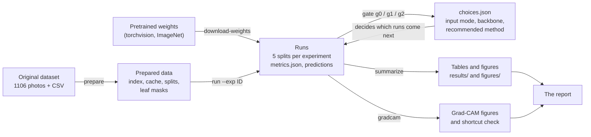

In words:

1. **Data** (`prepare`): read every photo upright, shrink it to a manageable size, build five train/validation/test
   splits, find leaf masks for the white photos.
2. **Runs** (`run`): train a model for an experiment on the training photos of each split, pick the best epoch with the
   validation photos, score it on the test photos. Five splits give five scores.
3. **Gates** (`gate`): three decisions (input shape, backbone, final method) made by fixed rules on validation scores.
4. **Summarize** (`summarize`): turn the run folders into the tables and figures of the report.

The chain of experiments and decisions looks like this. The next chapters explain every box.

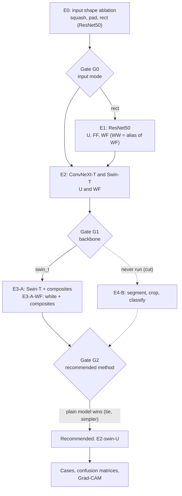

Dashed lines are the Method B branch, which was planned, built, tested once on development data and then cut
([chapter 5.9](#59-chapter-8-method-b-segment-then-crop-and-why-it-was-cut)).

### 5.2 Chapter 1: the data and its challenges

**The idea.** Before choosing any model, look at the data and let it tell you what is hard. Every design choice later
traces back to something in this list.

**What the photos look like.**

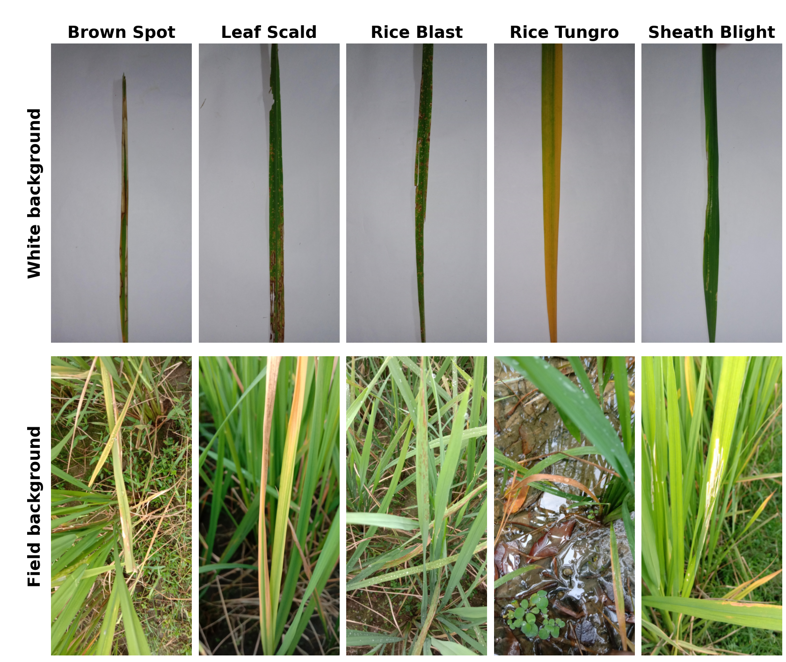

*Figure 2. Top: white background (one isolated leaf). Bottom: field (dense plants, soil, water). Columns are the five
diseases. File: `Dhan-Shomadhan/_work/figures/dataset_grid.png`, made by `prepare`.*

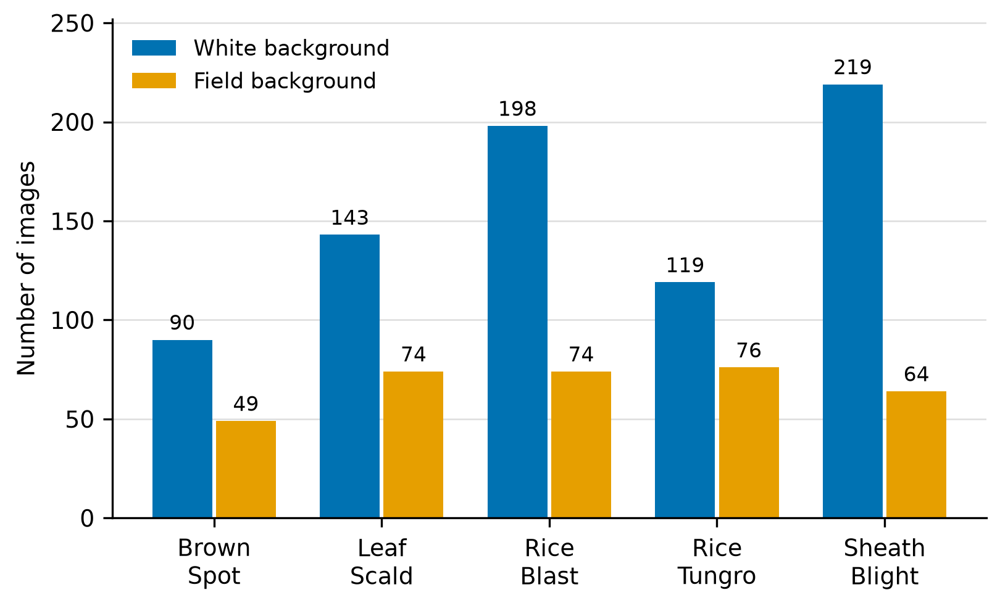

*Figure 3. Images per class and domain, from `Dhan-Shomadhan/_work/results/dataset_counts.md`.*

**The challenges, with the numbers we measured.**

| Challenge | What we measured | Why it matters | What we did |
|---|---|---|---|
| Small dataset | 1106 photos, about 780 for training in each split | Too few to train a network from scratch | Transfer learning from ImageNet |
| Two domains, uneven | 769 white vs 337 field; field Brown Spot has only 49 | Field is scarce and is the harder case | One model trained on both; transfer experiments |
| Class imbalance | 139 (Brown Spot) to 283 (Sheath Blight) photos | Accuracy would hide poor results on small classes | Report macro-F1; stratified splits |
| Tall, thin images | Nearly all 1952 x 4160 px (aspect 0.47); 6 are 1536 x 3264; 11 field photos are landscape | Squashing to a square distorts the leaf | Input shape ablation (E0); rotate landscape to portrait |
| Rotation tags | 381 photos carry an EXIF rotation tag (values 3, 6, 8) | Ignoring it feeds sideways leaves to the model | Apply EXIF on every read |
| Small leaf in field photos | White: the leaf covers 10.3% of the frame on average. Field (hand-annotated sample): about 7% (about 2% for Rice Tungro) | The model must find a small leaf in clutter | Leaf-finding idea (Method B), composites (Method A), Grad-CAM audit |
| Look-alike diseases | Brown Spot, Rice Blast and Leaf Scald share tan-brown lesions; Rice Tungro and some Brown Spot share yellow-orange tips | Confusions are expected | Look at confusion matrices and failure cases |
| Photographed in bursts | 36 groups of near-duplicate photos, 77 images in total, mostly consecutive field shots | A duplicate in train and test inflates the score | Keep each group in one split |

New terms:

- **EXIF orientation**: a small note inside a JPEG saying "rotate me by 90 degrees when showing". Phones write it
  instead of rotating the pixels. 381 of our photos have one.
- **Aspect ratio** is width divided by height. 0.47 means the photo is about twice as tall as wide.
- **Near-duplicates**: two photos of the same leaf or scene taken a moment apart (shifted, zoomed, rotated a bit).

**How the duplicate groups were found (a small dead end).** The first idea was a simple image hash (dHash): shrink
each photo to 9 x 8 pixels and compare. It flagged 1526 pairs but they were almost all unrelated leaves on a plain
wall, and it missed the real bursts because reframed shots defeat such a coarse hash. A one-off audit with local
features (SIFT, matched and verified geometrically with RANSAC) found the 36 groups. Example: `rtf_32` and
`rtf_33` share hundreds of verified matching points. The groups are in `annotations/duplicate_groups.json`, embedded in
the `.py` as `DUPLICATE_GROUPS`. The grouping is deliberately generous: a false group costs nothing, a missed
duplicate inflates a test score. Code of the audit: `tools/dup_audit/` (one-off, not part of the deliverable).

**Where to look.** Counts: `Dhan-Shomadhan/_work/results/dataset_counts.md`. Leaf size on white photos:
`white_mask_area.md`. Duplicate candidates: `near_duplicates.csv`. Code: notebook `10_data.ipynb` (`build_index`,
`read_rgb`, `build_cache`, `find_near_duplicates`).

### 5.3 Chapter 2: splits and leakage

**The idea.** A test score is only honest if the model never saw, directly or indirectly, the test photos. Seeing them
indirectly is called **leakage**. Example: if two near-identical photos of the same leaf land one in train and one in
test, the model "recognises" the leaf and scores well for the wrong reason. Another example: if you try three
learning rates and keep the one with the best test score, you have trained on the test set through your own choice.

**What we did.**

- **Five splits**, seeds 0 to 4. In each, photos are divided 70% train / 15% validation / 15% test, **stratified**
  (the proportions hold inside every class x domain group, so each split has about 47 field test photos).
- **Duplicate groups move as one unit**, so a burst never straddles train and test.
- **Validation chooses, test only reports.** Every decision (checkpoint epoch, learning rate, input shape, backbone,
  final method, number of composites) uses validation scores. Test scores are read after the decision is frozen.
- **Nothing derived from the test photos feeds training**: not the normalisation (we use the standard ImageNet mean and
  std, not statistics of our own data), not mask thresholds (tuned on a training sample), not the composite
  backgrounds (train photos only; the code raises an error if a validation or test photo is ever sampled).
- **Five splits give an error bar.** Every number is mean +- std of five scores. The std tells you how much the score
  moves when the train/test photos change. With only about 47 field test photos per split, it moves a lot.
- **Paired differences.** All models share the same five splits, so we also report the per-split *difference*
  between two models (for example E2-swin-U minus E1-U). Split-to-split luck mostly cancels in a difference, so it
  shows whether a gap is consistent.
- **A fingerprint per run.** Every `metrics.json` stores the split's SHA-256 and a fingerprint of the run's
  configuration. A run is redone automatically if either changes, and `summarize` skips (with a warning) runs that do not match.

**Sizes.** 773-780 train, 163-171 validation, 162-165 test photos per split. Because a photo is in the test part of
about 0.75 of the five splits on average, pooled test predictions cover 607 distinct photos (used in chapter 5.11).

**Where to look.** `Dhan-Shomadhan/_work/splits/split_k.json`; code: notebook `10_data.ipynb` (`make_split`,
`build_units`, `write_splits`).

### 5.4 Chapter 3: the classifier

**The idea.** With about 780 training photos we cannot train a deep network from scratch, so we start from a network
that already learned general visual features on ImageNet (1.2 million photos) and adapt it. That is **transfer
learning** from your course, here as **fine-tuning**: all weights are updated, gently.

**Three backbones, one fair comparison.**

| Backbone | Type | Parameters | Role |
|---|---|---|---|
| ResNet50 | classic CNN | 23.5 M | baseline |
| ConvNeXt-Tiny | modern CNN | 27.8 M | stronger CNN |
| Swin-Tiny | vision transformer (attention in shifted windows) | 27.5 M | transformer; same size as ConvNeXt-T, so "CNN vs transformer" is a controlled comparison |

All come from `torchvision` with ImageNet weights. The last layer is replaced by `Dropout(0.2)` + a 5-way linear layer.

**The input shape question (E0).** The photos are tall. A network wants a fixed input size. Three options at the same
pixel budget (about 100 000 pixels, so the comparison is about shape, not resolution):

| Mode | Input (H x W) | What it does |
|---|---|---|
| `squash` | 320 x 320 | resizes to a square, distorting the aspect (the leaf gets about 2x wider) |
| `pad` | 320 x 320 | keeps the aspect and fills the rest with grey (letterbox) |
| `rect` | 448 x 224 | keeps the tall shape (aspect 0.5 vs 0.47) |

Results with ResNet50 (macro-F1, mean +- std over 5 splits; validation is what gate G0 used):

| Mode | Validation mixed | Test white | Test field | Test mixed |
|---|---|---|---|---|
| squash | 0.780 +- 0.017 | 0.793 +- 0.043 | 0.697 +- 0.078 | 0.765 +- 0.024 |
| pad | 0.741 +- 0.027 | 0.797 +- 0.045 | 0.590 +- 0.127 | 0.736 +- 0.046 |
| rect | 0.767 +- 0.021 | 0.802 +- 0.062 | 0.687 +- 0.048 | 0.772 +- 0.049 |

`pad` is clearly worst on field (wasted pixels on grey). `squash` and `rect` are tied; gate G0 picked `rect` by its
tie rule (chapter 5.6). Source: `table_input_mode.md`.

**Augmentation** (random changes applied to training photos only, so the network sees more variety):

- random crop of 60-100% of the area (zoom and framing), horizontal and vertical flips, rotation up to +-15 degrees;
- colour jitter: brightness 0.2, contrast 0.2, saturation 0.15 and **hue only 0.02**.

Why the tiny hue jitter? Colour is evidence here. Rice Tungro leaves are yellow-orange, Brown Spot lesions are brown. A big
hue shift could turn one disease's colour into another's, so we leave hue almost alone. Evaluation photos are only
resized, never augmented.

**Training in two stages (LP-FT).** *Linear probe, then fine-tune.*

1. **Linear probe** (2 epochs): freeze the pretrained backbone, train only the new final layer, learning rate 1e-3.
2. **Fine-tune** (up to 30 epochs): unfreeze everything, AdamW optimiser, weight decay 0.05, learning rate 1e-4 (ResNet50,
   ConvNeXt-T) or 3e-4 (Swin-T), one epoch of linear warm-up then cosine decay.

Why two stages? A freshly initialised final layer is random. If you train everything at once, its large noisy
gradients flow into the good pretrained features and damage them. Training the head first avoids that.

Other settings: cross-entropy with **label smoothing** 0.1 (the target is 0.9 for the true class instead of 1.0, which
discourages over-confidence), batch size 32, gradient clipping at norm 1, mixed precision (fp16) on CUDA.

**Choosing the epoch: early stopping.** After every epoch the model is scored on the validation photos of the domains it
trained on. The weights of the best epoch are kept (`best.pt`). If 10 epochs pass without a new best, training stops.
This is your course's overfitting guard.

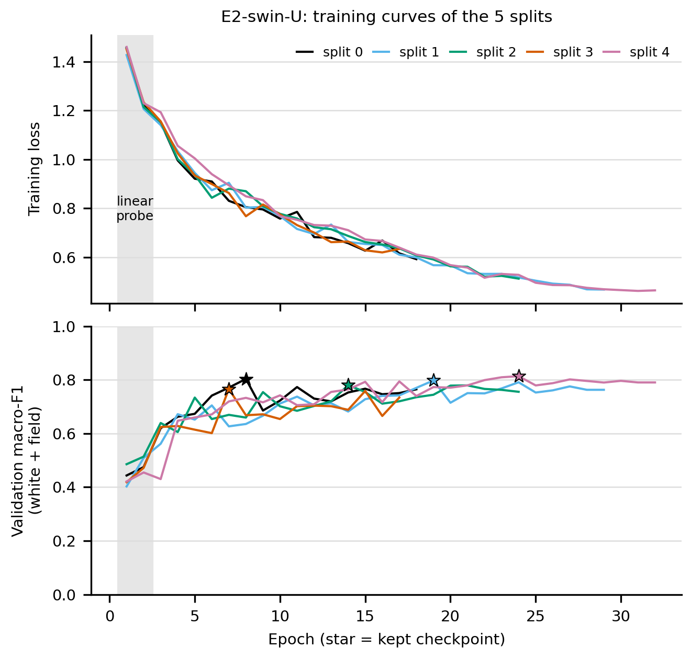

*Figure 4. E2-swin-U training. The grey band is the linear probe. Stars mark the kept checkpoint. Training loss keeps
falling, validation macro-F1 flattens early and then wobbles: more epochs would only memorise. File:
`Dhan-Shomadhan/_work/figures/training_curves_E2-swin-U.png`.*

**Macro-F1 and why it is the main metric.** Accuracy is the share of correct photos. **F1** of one class is the harmonic
mean of precision (of the photos predicted as this class, how many are right) and recall (of the photos of this class,
how many were found). **Macro-F1** averages the five class F1 scores with equal weight. Tiny example: 100 photos, 90 of
class A and 10 of class B, and a model that answers "A" for everything. Accuracy is 90%. F1 of A is 0.947, F1 of B is 0,
so macro-F1 is 0.474. Macro-F1 does not let big classes hide failure on small ones, and our classes range from 139 to
283 photos.

**"Mixed" is about 70% white.** The mixed scenario is the whole test split, so white dominates. We therefore also
report the **domain-balanced** score (the mean of the white and field scores).

**Where to look.** All hyperparameters actually used, read from each run's `config.json`:
`Dhan-Shomadhan/_work/results/table_hparams.md`. Code: notebook `20_classifier.ipynb` (`ImageTransform`, `build_model`,
`train_classifier`, `run_split`).

### 5.5 Chapter 4: experiment IDs

**The idea.** Every row of the experiment matrix has a short ID. Once you can read the ID you can find the run folder,
the table row and the figure.

**How to read an ID.**

| Piece | Meaning |
|---|---|
| `E0` | input-shape ablation (ResNet50): `E0-squash`, `E0-pad`, `E0-rect` |
| `E1` | ResNet50 baseline and domain experiments |
| `E2` | the two stronger backbones: `cnx` = ConvNeXt-T, `swin` = Swin-T |
| `E3-A` | Method A: composites added to the training data |
| `E4-B`, `S-seg` | Method B (classifier on leaf crops) and its segmenter. Not run (cut) |
| `-U` | **U**nified: trained on white + field photos together |
| `-WW` | trained on **W**hite, tested on **W**hite |
| `-FF` | trained on **F**ield, tested on **F**ield |
| `-WF` | trained on **W**hite, tested on **F**ield (cross-domain transfer) |
| `-WF` after `E3-A` | white photos plus composites, tested on field (see chapter 5.8 for the caveat) |

The three scenarios (white, field, mixed) are not separate experiments: they are three subsets of one test split, so
every unified model gives all three.

**Aliases: one training, several names.** To avoid training the same thing twice:

- `E1-U` is the winning E0 row (`E0-rect`), same run folder.
- `E1-WW` is `E1-WF`: both train on white photos and pick the checkpoint on white validation photos, so they are the
  same model. The WF run's metrics also hold its white test score, which is what the `E1-WW` row shows.
- `X-domain-WW` would alias the winning backbone's WF run (the X-domain rows were never needed).

**Sweeps.** A **sweep** tries a few values of one setting on split 0 and keeps the best by validation score:
learning rate in {1e-4, 3e-4} per backbone, and the number of composites per epoch for Method A. Sweep runs live in
`runs/sweep/` and are never reported as results. When the winning sweep run equals split 0 of the real run (same
config fingerprint and split), `choose-lr` copies it instead of retraining; that is why
`runs/E2-swin-U/split_0/` has a `provenance.json`.

**Which experiments exist as runs** (each has five split folders under `Dhan-Shomadhan/_work/runs/`):

| Experiment | Backbone | Trained on | Tested on | Hardware |
|---|---|---|---|---|
| E0-squash, E0-pad, E0-rect (= E1-U) | ResNet50 | white + field | W, F, mixed | Colab T4 |
| E1-FF | ResNet50 | field | field | Apple M2 (MPS) |
| E1-WF (= E1-WW) | ResNet50 | white | field (and white) | Apple M2 (MPS) |
| E2-cnx-U | ConvNeXt-T | white + field | W, F, mixed | Kaggle T4 |
| E2-cnx-WF | ConvNeXt-T | white | field (and white) | Kaggle T4 |
| E2-swin-U (recommended) | Swin-T | white + field | W, F, mixed | Kaggle T4 |
| E2-swin-WF | Swin-T | white | field (and white) | Kaggle T4 |
| E3-A | Swin-T | white + field + composites | W, F, mixed | Kaggle T4 |
| E3-A-WF | Swin-T | white + composites | field (and white) | Kaggle T4 |

That is 11 run folders x 5 splits = 55 reported runs. Because not everything ran on the same hardware, a few
cross-group gaps include hardware effects; `findings.md` (section Hardware) lists which comparisons cross groups.

### 5.6 Chapter 5: decision gates

**The idea.** Three choices could easily be made by peeking at results and picking what looks good. A **decision
gate** is a rule written down *before* the runs, applied to **validation** scores only. That makes the choice
defensible and leak-free. The rules are in `docs/instructions/README.md` and implemented in `gate g0|g1|g2`.

All three use the **mean validation mixed macro-F1 over the 5 splits**. Two candidates are **tied** when the gap
between their means is no larger than the larger of their two standard deviations ("within one std"). Ties are broken
differently per gate:

| Gate | Chooses | Candidates | If the top two are tied |
|---|---|---|---|
| G0 | input mode | squash, pad, rect (ResNet50) | prefer `rect` (it keeps the leaf's shape at no extra cost) |
| G1 | backbone | ResNet50 (E1-U), ConvNeXt-T, Swin-T | prefer the higher **validation field** macro-F1 (field is the harder, more valuable domain) |
| G2 | recommended method | plain G1 model, Method A (Method B cut) | prefer higher validation field macro-F1; if also tied, the **simpler** method (plain, then A, then B) |

**What each gate decided, with the numbers** (validation, mean +- std over 5 splits):

| Gate | Evidence | Outcome |
|---|---|---|
| G0 | mixed: squash 0.780 +- 0.017, rect 0.767 +- 0.021, pad 0.741 +- 0.027. Gap squash - rect = 0.013, tolerance 0.021 | tie, so **rect** |
| G1 | mixed: ConvNeXt-T 0.801 +- 0.012, Swin-T 0.792 +- 0.019, ResNet50 0.767 +- 0.021. Top gap 0.008, tolerance 0.019: tied. Field: Swin-T 0.753, ConvNeXt-T 0.739 | **Swin-T** (higher field) |
| G2 | mixed: plain 0.792 +- 0.019, Method A 0.785 +- 0.015 (gap 0.007, tied). Field: plain 0.753 +- 0.089, A 0.765 +- 0.049 (gap 0.012, tolerance 0.089, tied) | tied twice, simpler wins: **plain, E2-swin-U** |

Learning-rate sweeps (split 0, validation mixed macro-F1, 1e-4 vs 3e-4): ResNet50 0.774 vs 0.752 (chose 1e-4),
ConvNeXt-T 0.810 vs 0.788 (chose 1e-4), Swin-T 0.773 vs 0.803 (chose 3e-4). Composites per epoch for Method A
(split 0): 0.5x of the white training count (269 per epoch) 0.790 vs 1x (538) 0.773, so 0.5x.

Something worth understanding: the gates mostly resolved **ties**. The honest reading is that the three backbones,
and plain vs Method A, are not separable with 5 splits of about 160 test photos. The gates make a principled choice
under that uncertainty; they do not prove Swin-T is better. On test, the recommended model has the highest mean on *no*
scenario (ResNet50 leads white and mixed by 0.004 and 0.009, ConvNeXt-T leads field by 0.019, all within one std).
The test numbers were not used to revisit any gate.

All evidence is stored in [`choices.json`](Dhan-Shomadhan/_work/results/choices.json) (look at the `evidence` blocks)
and in the auto-generated sections of `findings.md`. Code: notebook `50_analysis.ipynb` (`decide_g0`, `decide_g1`,
`decide_g2`, `within_one_std`).

### 5.7 Chapter 6: domain transfer - the real finding

**The idea.** The research question: does knowledge from white photos transfer to the field? We answer it by training on
one domain and testing on the other, and compare with training on the right domain and on both.

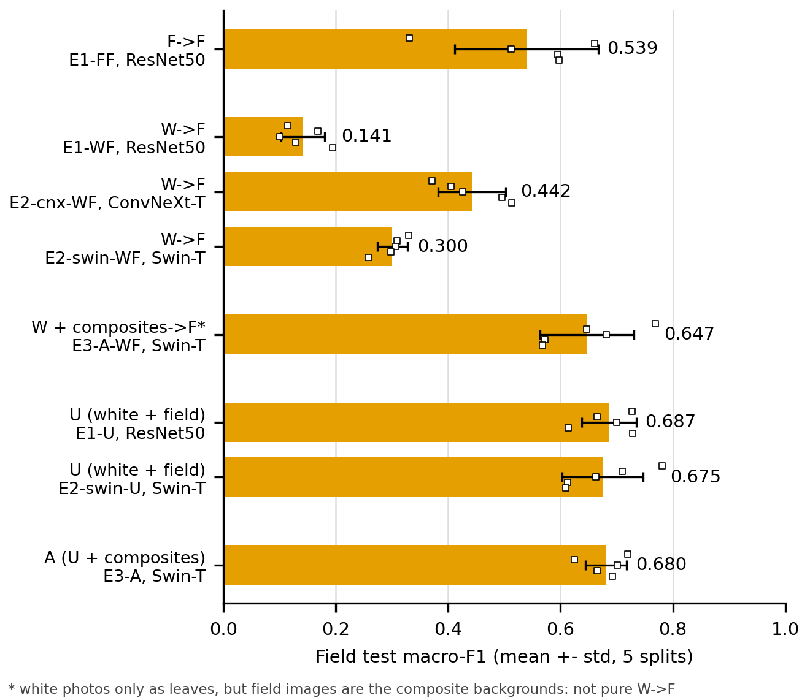

*Figure 5. Field test macro-F1 by training recipe. File: `Dhan-Shomadhan/_work/figures/domain_gap.png`.*

**Test results** (`table_domains.md`, mean +- std over 5 splits):

| Experiment | Trained on | White macro-F1 | Field macro-F1 | Field accuracy (%) |
|---|---|---|---|---|
| E1-WW / E1-WF (ResNet50) | white | 0.809 +- 0.037 | **0.141 +- 0.039** | 24.5 +- 4.0 |
| E1-FF (ResNet50) | field | - | 0.539 +- 0.128 | 55.2 +- 11.4 |
| E1-U (ResNet50) | white + field | 0.802 +- 0.062 | 0.687 +- 0.048 | 68.8 +- 4.6 |
| E2-cnx-WF (ConvNeXt-T) | white | 0.805 +- 0.044 | 0.442 +- 0.060 | 47.2 +- 4.8 |
| E2-swin-WF (Swin-T) | white | 0.809 +- 0.031 | 0.300 +- 0.027 | 33.4 +- 3.0 |
| E3-A-WF (Swin-T + composites) | white + composites | 0.799 +- 0.052 | 0.647 +- 0.084 | 65.5 +- 7.2 |

Three questions, answered:

1. **Is there a domain gap?** Yes, huge. ResNet50 trained on white photos gets 0.141 on the field, against 0.539 when
   trained on field photos (paired difference -0.398 +- 0.108; the field-trained model is ahead in all 5 splits). White
   photos alone do not teach the model to see leaves in clutter. Random guessing among five classes scores roughly 0.2, so 0.141 is
   below chance.
2. **Does white data help the field?** Yes. Training on white + field (E1-U, 0.687) beats field only (E1-FF, 0.539):
   +0.147 +- 0.159, ahead in 5 of 5 splits. The 769 white photos add disease knowledge that carries over once the model has
   seen a little field.
3. **Does field data hurt white?** No. White test 0.802 for U vs 0.809 for white-only (paired -0.007 +- 0.048): no
   measurable cost.

**What collapses.** E1-WF predicts almost everything as Leaf Scald or Sheath Blight; Brown Spot, Rice Blast and
Rice Tungro all score F1 0. The confusion matrix shows it:

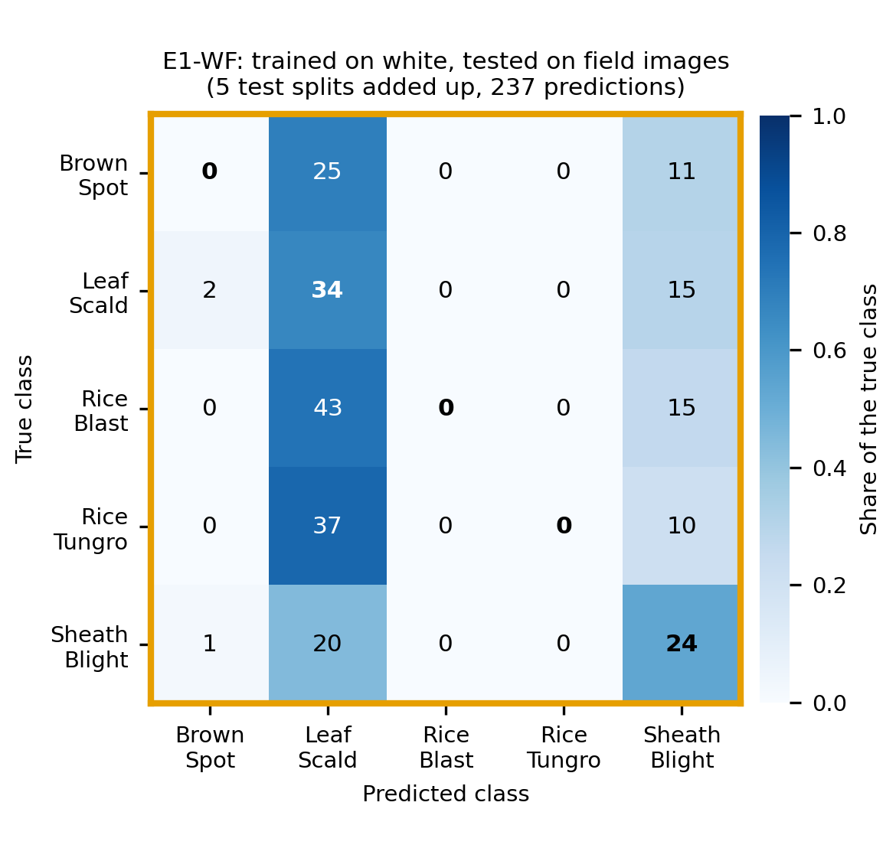

*Figure 6. Rows: true class. Columns: predicted. Numbers are photo counts summed over 5 test splits (237 photos).
File: `Dhan-Shomadhan/_work/figures/confusion_E1-WF_field.png`.*

We checked that this is real, not a Mac numerics bug (E1-WF ran on the Apple GPU): the split-0 checkpoint re-run on CPU
gives the same top class on 46 of 47 field test photos. An untested hypothesis for why ResNet50 collapses worse than
the others: ResNet50 uses BatchNorm, whose running statistics come from white photos only, while ConvNeXt-T and Swin-T
use LayerNorm (per image). That fits 0.141 vs 0.442 and 0.300, but we did not test it.

Composites (next chapter) lift Swin-T trained without real field photos from 0.300 to 0.647, which is within
0.028 +- 0.032 of the unified model's 0.675.

Where to look: `table_domains.md`, answers 1-4 in `findings.md` (section "Domain transfer questions"), figures
`domain_gap.png`, `confusion_E1-WF_field.png`, `confusion_E2-swin-WF_field.png`, `confusion_E3-A-WF_field.png`.

### 5.8 Chapter 7: Method A, pasting white leaves onto field photos

**The idea.** We have lots of clean white photos and few field photos. What if we cut the leaf out of a white photo and
paste it onto a field photo of the *same disease class*? Each such **composite** is a new training image that looks
like a field photo, carries a real lesion texture, and has a known label. Hope: it teaches "disease on a leaf in
clutter" from white data.

**Step 1: pseudo-masks.** To cut a leaf out we need its outline. On a white sheet that is easy to automate: paper has
low colour saturation, the leaf has high saturation. We take the HSV saturation channel, threshold it with Otsu's
method (an automatic threshold between two peaks of a histogram), drop dark shadow pixels, clean up with
morphological close/open, fill holes and keep the largest blob. This is a **pseudo-mask**: an automatically made mask, not a
hand-drawn one. Nattan reviewed contact sheets of all 769 masks and rejected 33 (95.7% accepted); the reject list is
`annotations/white_rejects.json`, embedded in the `.py` as `WHITE_REJECTS`.

**Step 2: the composite recipe.** Leaf from a white **training** photo, background from a field **training** photo of the same class
(never the 30 annotated photos or their near-duplicates). Then, to remove tell-tale artefacts (recipe v2): the leaf's
base sits on or below the bottom edge and leans along the background's leaves; its colour and lightness are matched
to the local vegetation; edges are eroded, paper-coloured pixels cut and the rim recoloured; the background is blurred a bit
(shallow depth of field); the mask is feathered and sometimes a soft shadow is added. A fresh batch of composites is
generated every epoch (269 per epoch, which is 0.5x the white training count, chosen on split-0 validation).

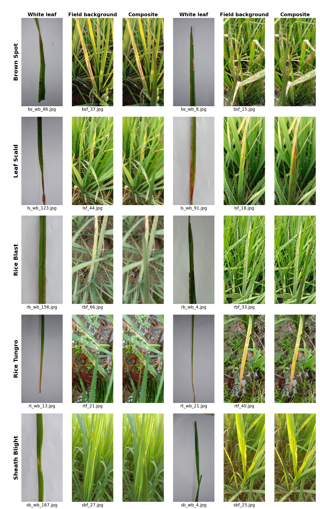

*Figure 7. White leaf + field background -> composite, two examples per class. File:
`Dhan-Shomadhan/_work/figures/composites_examples.png`, made by `prepare`.*

**Shortcut risk, and the blind realism check.** A network can learn the *pasting artefacts* instead of the disease:
a flat bright leaf with a soft edge in the middle of a photo means "this is a composite" and tells it nothing about
the label. To test how visible the paste is, Nattan looked at a shuffled sheet of 20 composites and 20 real field photos, **blind**
(without the answer key), and guessed which were composites. The pass rule was written beforehand: fewer than 26 of 40
correct, which is what a one-sided binomial test at p < 0.05 would call better than guessing.

| Check | Result |
|---|---|
| v1 recipe | 12 photos flagged, all 12 really composites; 12 of 20 composites found; 32 of 40 correct. Tells named: brightness and colour not matching the scene, leaf floating or entering from the top, remnant of white paper. **Failed.** |
| v2 recipe (new seed) | 18 flagged; 13 composites found of 20, 5 false alarms; 28 of 40 correct (p = 0.008). **Still failed the pre-stated rule**, though less cleanly. Tell now: the **pose**. A pasted leaf is flat and whole, while real field leaves overlap and are partly hidden. Colour matching cannot fix that, because white photos are shot flat. |

Everything reported is scored on real photos only, so detectable composites cannot inflate a number. They can only make
the extra training data less useful.

**Results.** Test macro-F1 (mean +- std over 5 splits):

| | White | Field | Mixed |
|---|---|---|---|
| E2-swin-U (plain) | 0.798 +- 0.053 | 0.675 +- 0.072 | 0.763 +- 0.033 |
| E3-A (plain + composites) | 0.776 +- 0.014 | 0.680 +- 0.037 | 0.750 +- 0.013 |
| E3-A minus plain (paired) | -0.022 +- 0.049 | +0.005 +- 0.074 | -0.013 +- 0.032 |

- **E3-A: no gain.** The same on validation (mixed 0.785 vs 0.792). Once the model sees about 240 real field photos per
  split, the composites add nothing. One visible side effect: E3-A's score varies about half as much across splits
  (test mixed std 0.013 vs 0.033), though five splits is little evidence.
- **E3-A-WF: big gain.** Without any real field photo for training, composites lift Swin-T from 0.300 to
  **0.647 +- 0.084** (paired +0.347 +- 0.063, ahead on 5 of 5 splits), with white unchanged (0.799 vs 0.809).
  Caveat: field photos are still used as composite *backgrounds* (and their class picks the background), so this is
  "white + field backgrounds", not pure white-to-field transfer.
- **Reading.** Composites carry most of the field signal when real field leaves are absent, and add nothing when they
  are present. We did not keep iterating on the recipe, because repeated tries scored on the same validation splits
  would make a chance win likely.

Where to look: `table_methods.md`, `table_domains.md`, `findings.md` (sections "Composite realism check" and "Method A"),
`composites_realism_key.json` (the answer key of the blind check), `white_mask_area.md`. Code: notebook
`30_copy_paste.ipynb` (`white_pseudo_mask`, `make_composite`, `CompositePool`, `CompositeSource`).

### 5.9 Chapter 8: Method B, segment then crop, and why it was cut

**The idea.** In a field photo the diseased leaf is small. If a first network could find the leaf and crop to it, the
classifier would see a clean, zoomed view like a white photo. **Method B** is a two-step pipeline: *segment* (a network
that marks which pixels belong to the salient leaf), *crop* (to the box around it, with a 15% margin to keep some
context), *classify* (with the same Swin-T).

**The catch.** We have no leaf masks for field photos. The plan was to train the segmenter only on composites (where
the pasted leaf's mask is known) and white photos with pseudo-masks, then **measure** it on 30 field photos whose leaf
outline Nattan drew by hand (`annotations/field_salient_leaf.json`, labelled with the "salient leaf" protocol: the leaf
that is in focus, shows symptoms and is closest to the centre). 10 of the 30 were a development set, 20 an evaluation
set kept unseen.

**What happened.** One development run (split 0, 8 epochs), measured on the 10 development annotations:

| Where | Result |
|---|---|
| Validation composites | IoU 0.73 (good) |
| White validation pseudo-masks | IoU 0.92 (good) |
| **Real field photos (10 dev annotations)** | **IoU 0.000**; 9 of 10 photos found no leaf and fell back to the whole image. 311 of 337 field photos fell back |
| Swapped architecture (DeepLabV3), allowed once | IoU 0.015, 8 of 10 fallbacks |
| Best post-processing tweak (threshold, minimum area) | IoU 0.05, 1 of 10 boxes holding at least half the leaf |

**Why.** In every composite, the *pasted* leaf is the target and everything else, including every real field leaf, is
background. The network learned a simpler rule than the one we wanted: "pasted white-photo leaf vs real leaf". On a real
field photo it rejects the real leaf as "background". It found a shortcut for the task we set it.

**Decision.** Method B was cut (decision P8) and the segmenter reported as a negative development finding. The 20 evaluation
annotations were never used for the segmenter (they were used for the Grad-CAM check instead). The code for
Method B (segmenter training, crop boxes, `predict` with crop) is complete and covered by `smoke`, but no per-split
segmenters were trained, so `table_segmenter.md` reads `pending` and `E4-B` rows in `table_methods.md` read `pending`.

A real leaf mask from a few hand-labelled field photos in training would likely fix the shortcut; that is the first
suggested improvement in chapter 5.13.

### 5.10 Chapter 9: the final results

**Test results of the three unified models and Method A** (`table_required.md`, `table_methods.md`; mean +- std over 5
splits; macro-F1 with accuracy % in brackets):

| Experiment | White (a) | Field (b) | Mixed (c) |
|---|---|---|---|
| E1-U, ResNet50 | 0.802 +- 0.062 (82.9 +- 5.2) | 0.687 +- 0.048 (68.8 +- 4.6) | 0.772 +- 0.049 (78.8 +- 4.6) |
| E2-cnx-U, ConvNeXt-T | 0.791 +- 0.035 (82.2 +- 3.1) | 0.694 +- 0.079 (70.0 +- 7.1) | 0.764 +- 0.010 (78.6 +- 0.8) |
| **E2-swin-U, Swin-T (recommended)** | **0.798 +- 0.053 (82.7 +- 4.9)** | **0.675 +- 0.072 (67.6 +- 6.0)** | **0.763 +- 0.033 (78.3 +- 3.6)** |
| E3-A, Swin-T + composites | 0.776 +- 0.014 (80.5 +- 1.8) | 0.680 +- 0.037 (68.8 +- 4.5) | 0.750 +- 0.013 (77.1 +- 2.1) |

The domain-balanced macro-F1 of the recommended model is 0.736 +- 0.036.

**The honest tie.** The three unified models are within one standard deviation of each other on every scenario. Paired
differences confirm it (E2-swin-U minus E1-U: white -0.004 +- 0.032, field -0.012 +- 0.070, mixed -0.009 +- 0.019;
E2-swin-U minus E2-cnx-U: white +0.006 +- 0.027, field -0.019 +- 0.062, mixed -0.001 +- 0.036). The report says so
plainly: the three backbones cannot be separated on this test set. What we can say with confidence is bigger:
field is harder than white (0.675 vs 0.798), transfer from white alone fails, and composites help only when
real field photos are absent.


*Figure 8 (same as Figure 1). Look at the markers: for field, the five splits of one model spread between about 0.61
and 0.78.*

**Per-class results of the recommended model** (test F1, mean +- std over 5 splits; `table_per_class.md`):

| Class | White F1 | Field F1 |
|---|---|---|
| Brown Spot | 0.692 +- 0.134 | 0.657 +- 0.217 |
| Leaf Scald | 0.731 +- 0.100 | 0.501 +- 0.083 |
| Rice Blast | 0.844 +- 0.054 | 0.637 +- 0.055 |
| Rice Tungro | 0.768 +- 0.055 | 0.693 +- 0.106 |
| Sheath Blight | 0.953 +- 0.029 | 0.887 +- 0.081 |

Sheath Blight is the easiest in both domains; Leaf Scald is the hardest in the field.

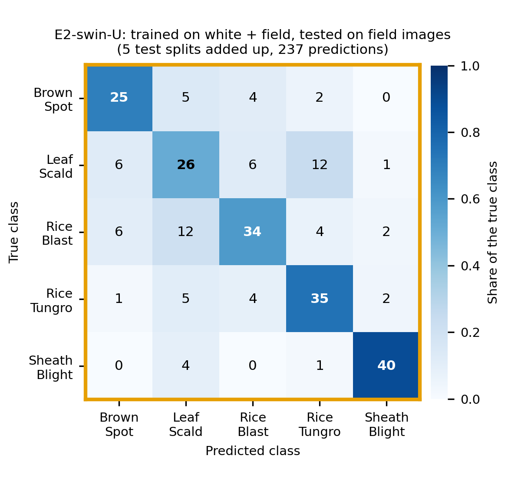

*Figure 9. E2-swin-U on field test photos, counts summed over 5 splits (237 photos). The largest confusions: Leaf Scald
predicted as Rice Tungro (12), Rice Blast predicted as Leaf Scald (12), Leaf Scald predicted as Brown Spot or Rice Blast
(6 each). File: `Dhan-Shomadhan/_work/figures/confusion_E2-swin-U_field.png`. The white version is
`confusion_E2-swin-U_white.png`.*

**Cost** (`table_runtime.md`): one forward pass of one photo on an 8-core Mac CPU takes 63 ms (ResNet50), 78 ms (Swin-T)
and 857 ms (ConvNeXt-T; a slowdown we did not investigate). Training one run on a T4 takes about 9 minutes for ResNet50,
8 for ConvNeXt-T, 7.6 +- 2.1 for Swin-T and 15 for Method A.

### 5.11 Chapter 10: success, failure and challenging cases

**The idea.** A score hides *which* photos fail and why. Because each photo appears in the test part of about 0.75 of the
five splits, we pool the test predictions of the recommended model over all 5 splits (607 distinct photos) and sort
photos into three groups:

| Group | Rule | Count |
|---|---|---|
| Consistent success | right in every split where tested, and its top probability never below 0.5 | 428 (333 white, 95 field) |
| Consistent failure | wrong in every split where tested | 119 (70 white, 49 field) |
| Challenging | right in some splits and wrong in others, or right but with top probability below 0.5 | 60 (30 white, 30 field) |

Most frequent failure pairs (true -> predicted): Leaf Scald -> Rice Blast (15), Leaf Scald -> Rice Tungro (13),
Brown Spot -> Rice Blast (11). Caution: 95 of the 119 failures were tested in only one split.

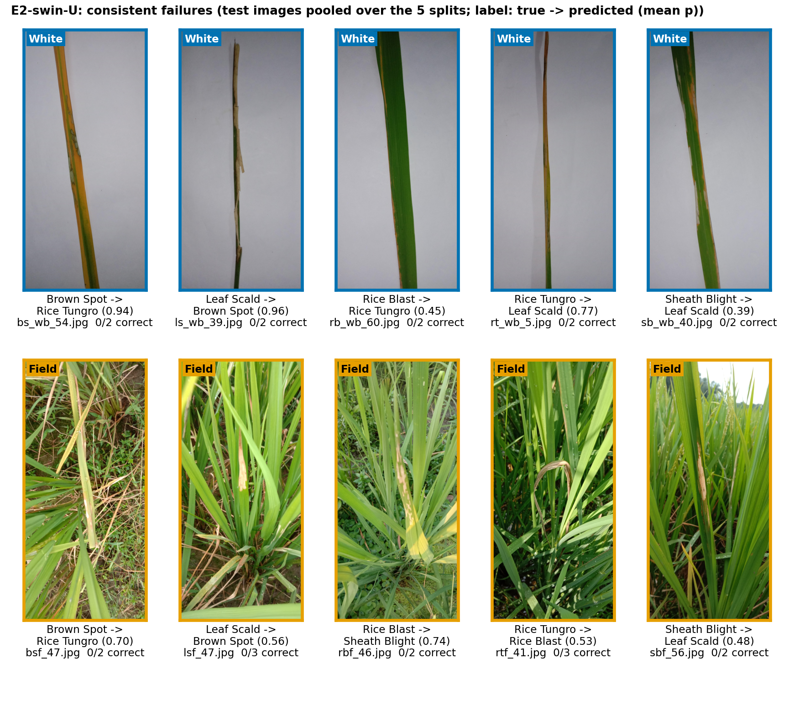

*Figure 10. Consistent failures. Contact sheets of successes and challenging cases:
`Dhan-Shomadhan/_work/figures/cases_success.png`, `cases_challenging.png`. The per-photo list is
`Dhan-Shomadhan/_work/results/cases.csv`.*

**The four failure modes.** Nattan looked at each of these 10 photos and wrote a hypothesis (in `findings.md`, section
"Failure hypotheses"). They group into four modes:

1. **The visible symptoms match another class** (3 white photos). Two leaves (`bs_wb_54`, `rb_wb_60`) show yellow-orange
   tips and margins typical of Rice Tungro and were predicted Rice Tungro. `ls_wb_39` (Leaf Scald) shows torn tan
   bands that Brown Spot training photos also carry. Either the classes overlap at some disease stages, or a photo has
   a second condition: a limit of one label per photo.
2. **Look-alike lesions that differ only in fine cues** (2 field). `rbf_46` (Rice Blast -> Sheath Blight) and
   `sbf_56` (Sheath Blight -> Leaf Scald, a near tie at 0.50). The lesion centres look alike; what separates the classes is
   border colour and where on the plant the lesion sits. A whole-photo classifier has no notion of position on the plant.
3. **The key symptom is too fine or faint** (3). `rt_wb_5` (Leaf Scald's chevron bands cannot be resolved at this size),
   `sb_wb_40`, `rtf_41` (a withered plant with barely visible discolouration). The model sees each photo at 448 x 224,
   about a third of the cached long side.
4. **Field clutter** (2 field). `bsf_47` and `lsf_47`: the symptom is a small part of a busy scene. This is the failure
   Method B was designed for.

These ten illustrate failure modes; they are not frequencies.

### 5.12 Chapter 11: Grad-CAM and the shortcut check

**The idea.** **Grad-CAM** colours the image regions that most raised the predicted class's score, using the gradients at
the last network stage. It lets us ask "is the model looking at the leaf, or at the background?". Looking at the
background would be a **shortcut**: a pattern that correlates with the label in this dataset but is not the disease.

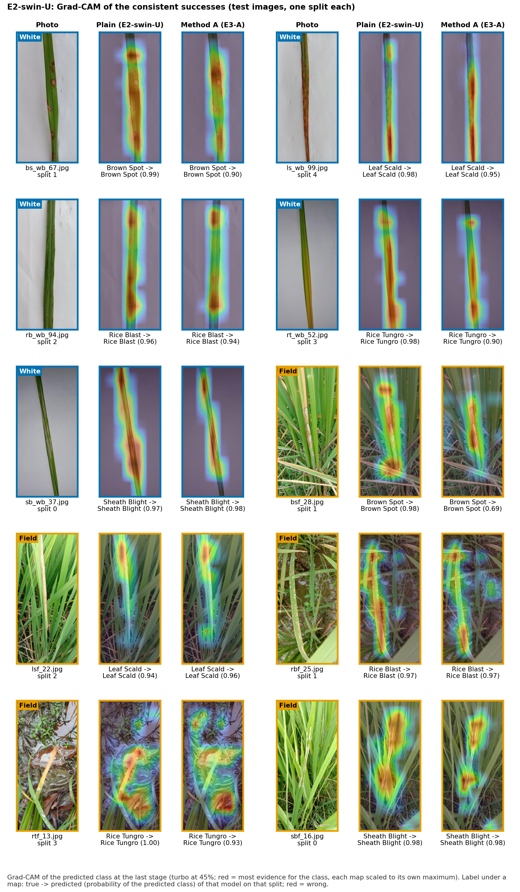

*Figure 11. Grad-CAM of successes for the plain model (E2-swin-U) and Method A (E3-A). Red means most evidence. On white
photos the maps sit on the lesions. Note the field Rice Tungro example (`rtf_13`, bottom left): much of the map is on the
muddy water. Files: `gradcam_success.png`, `gradcam_failure.png`, `gradcam_annotated.png` in
`Dhan-Shomadhan/_work/figures/`; made by `gradcam`.*

**Quantitative check.** Using the 30 hand-annotated field photos (each counted in every split where it was a test or
validation photo, never a training photo: 43 photo-split pairs from 24 photos), we measured the share of Grad-CAM energy
inside the annotated leaf. A uniform map would put 0.072 inside (the leaf's area share).

| Model | Share of map on the leaf | Times chance |
|---|---|---|
| Plain, E2-swin-U | 0.244 +- 0.192 | 3.4x |
| Method A, E3-A | 0.240 +- 0.209 | 3.3x |
| Paired A - plain | -0.004 +- 0.136 (A ahead in 17 of 43 pairs) | |

Both models look at the leaf about 3.4 times more than chance, and composites do **not** move that. This is a null result
for the motivation "composites teach the model to ignore the background". Grad-CAM at the last stage is coarse, so read
this as a direction and a size, not a proof (`table_gradcam.md`).

**A possible Rice Tungro shortcut.** On two correct Rice Tungro field predictions (`rtf_13`, `rtf_24`) both models put
most of the map on muddy water and soil. Nattan counted muddy water in the background of about 40 of the 76 Rice Tungro
field photos. In the annotated sample the Tungro leaf is only about 2% of the frame (6-12% for the other classes), and
the plain model's map falls inside it 3.2x chance, against 3.9-4.2x for three other classes. So the model may partly
recognise the Tungro *scene* rather than the symptom. This is **possible, not confirmed**: the share of muddy
backgrounds in the other classes was not counted, and there are only 9 Tungro pairs. A clean test would compare
Tungro F1 on field photos with and without mud.

### 5.13 Chapter 12: limitations and how the method could be improved

Limitations, honestly:

- Field results are lower and noisier than white (0.675 +- 0.072 vs 0.798 +- 0.053), and rest on about 47 test photos per split.
- The backbones are statistically tied; the recommended one was chosen by rule, not by a win.
- Leaf Scald is often confused with Rice Blast and Rice Tungro; labels are one per photo, so overlapping stages cannot be expressed.
- A possible background shortcut for Rice Tungro (above).
- Results come from three different hardware setups (Colab T4, Kaggle T4, an Apple M2), so a few cross-group gaps include hardware effects.
- Method B and the composites' realism did not work as hoped.

How the **method** (not the dataset) could be improved:

1. **Explicit leaf localisation trained with a few real field masks.** The composite-trained segmenter learned
   "pasted vs real"; even ~30 real masks in training would remove that shortcut. We kept 30 for evaluation only.
2. **More realistic composites**: varied pose, partial occlusion by neighbouring leaves, learned colour harmonisation. The flat pasted leaf was the tell.
3. **Higher-resolution or tiled input**: 448 x 224 is a third of the cached resolution and fine cues (chevron bands) vanish.
4. **Test-time augmentation and ensembles** of the 5 split models.
5. **Use unlabelled field photos**: semi-supervised training or domain-adversarial training.
6. **Multi-leaf / multiple-instance classification** for canopies, instead of one label for a crowded photo.

---

## 6. Decision history, dead ends and lessons

### 6.1 Timeline of the key decisions

Dates are 2026. Full detail: `docs/instructions/README.md` (decisions D1-D13 and P1-P9) and `git log`.

| Date | What happened | Why it matters |
|---|---|---|
| 7-8 Oct | Dataset audit notebook (`notebooks/00_dataset_audit.ipynb`): counts, image sizes, EXIF tags | Found the facts of chapter 5.2 |
| 11 Oct | Decisions D1-D13 and defaults P1-P7 written down, **including the gate rules, before any experiment ran**. Python file generated from notebooks from day one | The rules could not be tuned to the results |
| 11-12 Oct | Splits made group-aware after the SIFT audit found 36 duplicate groups (the dHash audit found none) | Closes a leakage path |
| 12 Oct | E0 on Colab: gate G0 -> `rect` by the tie rule | First decision, first tie |
| 12-13 Oct | Colab GPU quota ran out; a platform-aware runner moved GPU batches to Kaggle (T4 x2). E1 (ResNet50 domain experiments) had run on the Apple M2 | Why runs come from three hardware setups |
| 13 Oct | E2 (ConvNeXt-T, Swin-T) and gate G1 -> Swin-T (tie, higher field F1) | |
| 13 Oct | Blind realism check of composites v1 fails (12 of 20 found, no false alarm). Recipe v2 (P9) written, one change per named tell | Do not train on composites that give themselves away |
| 13 Oct | Segmenter development run: dev IoU 0.000 on real field photos. **Method B cut** (P8) | Negative finding reported honestly |
| 13 Oct | E3-A and E3-A-WF trained; blind check of v2 still fails (28 of 40 correct). Gate G2 -> plain model (tied twice, simpler wins), then test tables opened | The rule was applied before looking at test |
| 13-14 Oct | Checkpoints retrained for Grad-CAM (byte-identical predictions); Grad-CAM, failure-case hypotheses, Tungro muddy-water observation | |
| 14 Oct | **`results-freeze`** tagged. Afterwards: `reproduce` command, frozen decisions embedded in the `.py` | From here the report's numbers come only from the tag |

### 6.2 What did not work, and what we learned

| What did not work | What we learned |
|---|---|
| dHash for duplicates: 1526 candidates, none real | A hash that is too coarse misses reframed burst shots. Verify with geometry (SIFT + RANSAC) |
| Composites v1: visibly pasted (colour, floating leaf, paper remnant) | Test realism **blind** and fix each named tell. A pre-stated pass rule keeps it honest |
| Composites v2: still found (28/40), tell is leaf pose | Colour matching cannot fix a flat white-photo pose. Realism needs pose and occlusion |
| Segmenter trained only on composites | If everything real is "background" in training, the network learns "pasted vs real". Training targets must match the deployment task |
| Method A with real field photos: no gain | Synthetic data adds value only where real data is absent (E3-A-WF 0.300 -> 0.647) |
| ResNet50 white-only collapse (0.141) | Domain shift is not a small drop. Checked it was not a hardware bug before believing it |
| Choosing a backbone by test score | Impossible here: they tie. Rules on validation scores, fixed in advance, keep the choice honest |

Three habits that shaped the project and are worth keeping: write the decision rule before you see the numbers;
report negative results with their numbers; keep the test set for reporting only.

---

## 7. Evidence map

Every number and figure in the report traces to a file under `Dhan-Shomadhan/_work/`. The report itself is not in git;
its section, table and figure numbers below are those of the submitted version.

### 7.1 Report sections, tables and figures

| Report part | Evidence file(s) under `Dhan-Shomadhan/_work/` unless stated | Command that regenerates it |
|---|---|---|
| 2 Executive summary | numbers from `results/table_required.md`, `results/table_domains.md`, auto block "Required scenarios" of `results/findings.md` | `summarize` |
| 3 Problem description: counts, aspect, EXIF | `results/dataset_counts.md`, `index.json`, `docs/instructions/dataset-tree.txt` (outside `_work/`) | `prepare` |
| 3 leaf share on white photos (10.3%) | `results/white_mask_area.md` | `prepare` |
| 3 near-duplicates (36 groups, 77 images) | `results/near_duplicates.csv` (dHash candidates), `annotations/duplicate_groups.json` and `tools/dup_audit/results/summary.md` (outside `_work/`) | `prepare`; the SIFT audit is one-off (`tools/dup_audit/`) |
| 3 **Table 1** (challenges -> design) | hand-written, no file | - |
| 3 **Fig. 1** (dataset) | `figures/dataset_grid.png` (a) and `figures/class_domain_counts.png` (b) | `prepare` |
| 4 Related work, 7 References | no file in `_work/`; early notes in `research-diary.md` | - |
| 5.1-5.2 recommended method, Algorithms 1 and 2 | pseudocode of `run_split` and `predict_image` (notebook `20_classifier.ipynb`); hyperparameters in `results/table_hparams.md` | `summarize` |
| 5.2 **Fig. 2** (block diagram) | drawn by hand for the report, no generated file | - |
| 5.3 **Table 3** (cost) | `results/table_runtime.md`, `results/inference_benchmark.json` | `benchmark` (inference), then `summarize` |
| 5.4 **Table 4** (modules) | hand-written; see [section 8.1](#81-notebooks-and-the-generated-py) | - |
| 5.5 Method A, Algorithm 3 | notebook `30_copy_paste.ipynb` (`make_composite`) | - |
| 5.5 **Fig. 3** (composites) | `figures/composites_examples.png` | `prepare` |
| 5.5 realism check (28 of 40 correct) | `results/findings.md` section "Composite realism check", `results/composites_realism_key.json` | the sheet is regenerated by `prepare`; the guesses were made by hand |
| 6.1 settings: splits, decisions | `splits/split_k.json`, `results/choices.json`, `results/table_hparams.md`, auto block "Hardware" of `findings.md` | `prepare`, `gate g0|g1|g2` |
| 6.2 **Table 5** (test results) | `results/table_required.md` (E1-U, E2-cnx-U, E2-swin-U), `results/table_methods.md` (E3-A), `results/table_input_mode.md` (E0-squash, E0-pad), `results/table_domains.md` (E1-FF, E1-WF, E2-cnx-WF, E2-swin-WF, E3-A-WF) | `summarize` |
| 6.2 gate text (G0, G1, G2) | `results/choices.json` (`evidence`), auto blocks "G0" and "G2" of `findings.md` | `gate g0`, `gate g1`, `gate g2 --cut B` |
| 6.2 domain transfer text | auto block "Domain transfer questions" of `findings.md`; figures `domain_gap.png`, `confusion_E1-WF_field.png`, `confusion_E2-swin-WF_field.png`, `confusion_E3-A-WF_field.png` | `summarize` |
| 6.2 Method B cut (IoU 0.000, 311 of 337) | `results/findings.md` section "Segmenter quality"; `results/table_segmenter.md` (all `pending`) | - (a one-off development run) |
| 6.3 **Fig. 4** (cases) | `figures/cases_success.png`, `cases_challenging.png`, `cases_failure.png`; list in `results/cases.csv` | `summarize` (needs `prepare` first for the cached photos) |
| 6.3 per-class numbers | `results/table_per_class.md`, `figures/confusion_E2-swin-U_field.png`, `confusion_E2-swin-U_white.png` | `summarize` |
| 6.3 failure modes | `results/findings.md` sections "Failure hypotheses" and "Failure modes" (hand-written) | - |
| 6.3 Grad-CAM (0.244 vs 0.240) | `results/table_gradcam.md`, `results/gradcam_energy.csv`, `figures/gradcam_success.png`, `gradcam_failure.png`, `gradcam_annotated.png` | `gradcam` (needs the retrained checkpoints) |
| 6.3 Rice Tungro muddy water | `results/findings.md` section "Possible background shortcut for Rice Tungro" | - |
| 8 **Table 6** (weights) | list printed by `download-weights`; files in `weights/hub/checkpoints/` | `download-weights` |
| 8 **Table 7** (reproduce steps) | `python group3-starvenus.py reproduce --help`; times from `results/table_runtime.md` | - |

Figures not mentioned in the report but tracked: `figures/training_curves_E2-swin-U.png` (`summarize`) and
`figures/scenario_bars.png` (`summarize`).

### 7.2 Worked example: 0.675 +- 0.072

Let us trace one number end to end: the recommended model's **field macro-F1, 0.675 +- 0.072**.

1. **Report.** Table 5, row E2-swin-U, column Field (b) F1: `0.675 +- 0.072`.
2. **Table file.** [`table_required.md`](Dhan-Shomadhan/_work/results/table_required.md), row `E2-swin-U (recommended)`,
   column "Field macro-F1": `0.675 +- 0.072`. The `.csv` twin has the same text.
3. **Five run files.** Each split's run folder has a `metrics.json`. The number lives at the path
   `test` -> `field` -> `macro_f1` in `Dhan-Shomadhan/_work/runs/E2-swin-U/split_k/metrics.json`:

| Split k | File | `test.field.macro_f1` | Field accuracy |
|---|---|---|---|
| 0 | `runs/E2-swin-U/split_0/metrics.json` | 0.7806 | 0.7660 |
| 1 | `runs/E2-swin-U/split_1/metrics.json` | 0.7102 | 0.7021 |
| 2 | `runs/E2-swin-U/split_2/metrics.json` | 0.6627 | 0.6596 |
| 3 | `runs/E2-swin-U/split_3/metrics.json` | 0.6126 | 0.6122 |
| 4 | `runs/E2-swin-U/split_4/metrics.json` | 0.6096 | 0.6383 |

4. **Mean and sample standard deviation** (n - 1 = 4 in the denominator):

   mean = (0.7806 + 0.7102 + 0.6627 + 0.6126 + 0.6096) / 5 = 0.6751 -> **0.675**
   std = 0.0720 -> **0.072**

   Accuracy the same way: mean 67.6 %, std 6.0 -> Table 5 `67.6 +- 6.0`.

You can check it yourself in a Python prompt (works on Mac and Windows; run from the repo root):

```python
import json, statistics
vals = [json.load(open(f"Dhan-Shomadhan/_work/runs/E2-swin-U/split_{k}/metrics.json"))["test"]["field"]["macro_f1"]
        for k in range(5)]
print(vals)
print(statistics.mean(vals), statistics.stdev(vals))   # stdev = sample std, like the report
```

Expected: the five values above, then `0.6751470189522417 0.07197349359480482`.

Two details that explain how robust this is:

- The field test set of each split has 47 to 49 photos (47, 47, 47, 49, 47). One more or fewer wrong photo moves a
  split's F1 by a few hundredths. That is why the std (0.072) is large and why the backbones tie.
- `runs/E2-swin-U/split_0/` was copied from the learning-rate sweep (the sweep run at 3e-4 is the same training), and
  its `provenance.json` says so. The `split_sha256` inside every `metrics.json` ties each run to its split file.

Another good practice example: **E3-A-WF's field macro-F1 0.647** from `table_domains.md`, then
`runs/E3-A-WF/split_k/metrics.json` the same way.

---

## 8. Code map (read-only)

You will not change the code, but it helps to know where each step lives.

### 8.1 Notebooks and the generated `.py`

`group3-starvenus.py` is **generated**. The source is the notebooks: every code cell whose first line is `#| export`
is copied, in order, by `tools/export_py.py` into the one file. Why: the deliverable must be a single Python file, but
notebooks are the better place to develop. The exporter also checks that only allowed packages are imported and that
the file compiles, and `tests/` always run against the generated file. Never edit the `.py`; a test checks that it is
in sync with the notebooks.

| Step of the method | Notebook | Main functions / classes |
|---|---|---|
| Find the photos, labels from filenames, CSV check | `10_data.ipynb` | `find_images`, `classify_filename`, `build_index` |
| EXIF-correct reading, rotate to portrait | `10_data.ipynb` | `apply_orientation`, `to_portrait`, `read_rgb` |
| Resolution cache (1280 px) | `10_data.ipynb` | `build_cache` |
| Near-duplicate audit and groups | `10_data.ipynb` | `find_near_duplicates`, `duplicate_pairs`, `validate_duplicate_groups` |
| Splits | `10_data.ipynb` | `build_units`, `make_split`, `write_splits`, `load_split` |
| `prepare` | `10_data.ipynb`, `90_cli.ipynb` | `prepare_data`, `run_prepare` |
| Experiment registry and choices | `20_classifier.ipynb`, `90_cli.ipynb` | `ExperimentConfig`, `Choices`, `resolve_experiment`, `seed_choices` |
| Augmentation and input modes | `20_classifier.ipynb` | `ImageTransform`, `resize_exact`, `letterbox`, `random_crop`, `color_jitter` |
| Backbones, head, LP-FT freezing | `20_classifier.ipynb` | `build_model`, `head_parameters`, `backbone_parameters` |
| Training loop, early stopping | `20_classifier.ipynb` | `train_classifier`, `CheckpointSelector`, `lr_at_step` |
| One run on one split, run folder | `20_classifier.ipynb` | `run_split`, `result_state`, `config_fingerprint` |
| Metrics | `20_classifier.ipynb` | `classification_metrics`, `evaluate_model` |
| `predict` | `20_classifier.ipynb`, `90_cli.ipynb` | `predict_image`, `cmd_predict` |
| White pseudo-masks | `30_copy_paste.ipynb` | `white_pseudo_mask`, `prepare_pseudo_masks` |
| Composites (Method A) | `30_copy_paste.ipynb` | `make_composite`, `CompositePool`, `CompositeSource` |
| Hand annotations | `40_segmentation.ipynb` | `validate_field_annotations`, `prepare_annotations` |
| Segmenter and crop boxes (Method B) | `40_segmentation.ipynb` | `build_segmenter`, `train_segmenter`, `postprocess_probability`, `run_seg_split` |
| Aggregation: mean, std, paired differences | `50_analysis.ipynb` | `load_experiments`, `aggregate`, `paired_difference` |
| Tables | `50_analysis.ipynb` | `table_required`, `table_domains`, `table_methods`, `table_input_mode`, `table_per_class`, `table_hparams`, `table_runtime` |
| Decision gates | `50_analysis.ipynb` | `decide_g0`, `decide_g1`, `decide_g2`, `run_gate` |
| Figures | `50_analysis.ipynb` | `save_confusion`, `save_scenario_bars`, `save_domain_gap`, `save_training_curves` |
| Success/failure cases | `50_analysis.ipynb` | `case_rows`, `select_cases`, `save_case_sheet` |
| Grad-CAM and shortcut check | `20_classifier.ipynb`, `50_analysis.ipynb` | `grad_cam`, `cam_on_image`, `run_gradcam` |
| `summarize` | `50_analysis.ipynb` | `summarize` |
| `reproduce`, `smoke`, argument parser | `90_cli.ipynb` | `reproduce_steps`, `run_reproduce`, `cmd_smoke`, `run_cli` |

Not part of the `.py`, one line each: `notebooks/runner.ipynb` drives Colab and Kaggle runs (guide:
`docs/instructions/kaggle-guide.md`); `tests/` has 576 pytest tests against the generated file; `tools/dup_audit/` is the
one-off SIFT duplicate audit; `tools/labelme_to_annotations.py` converts the hand-drawn outlines;
`tools/export_py.py` builds the `.py`; `research-diary.md` and `implementation-plan.md` are early notes.

### 8.2 The commands

Global flags, accepted before or after any command: `--data-root PATH` (default `Dhan-Shomadhan`),
`--device {auto,cuda,mps,cpu}`, `--seed-offset N` (add to every seed), `--fast` (smoke settings: tiny subsets, 1 epoch).

| Command | What it does |
|---|---|
| `download-weights` | Fetch the torchvision pretrained weights into `_work/weights/` (idempotent) |
| `prepare` | Index, cache, near-duplicate audit, splits, leaf masks, dataset tables and figures (idempotent); also seeds `choices.json` from the frozen decisions |
| `run --exp ID` | Train and evaluate one experiment (or a group like `E0`, `E1`, `E2`, or a comma list) over the splits. Flags: `--splits 0,1`, `--force`, `--sweep-lr`, `--sweep-composites`, `--out-dir DIR`, `--batch-size`, `--grad-accum`, `--num-workers` |
| `choose-lr --backbone NAME` | Record (or verify) the learning rate of a backbone from its split-0 sweep |
| `choose-composites` | Record (or verify) the composites-per-epoch factor of Method A from its sweep |
| `gate g0\|g1\|g2` | Recompute decision gate G0 (input mode), G1 (backbone) or G2 (recommended method) from the runs and record or verify it. `g2` takes `--cut B` |
| `seg-eval` | Segmenter metrics on the annotated field photos (`--set dev`, or `--set eval --final`) |
| `summarize` | Aggregate all runs into tables, figures, failure cases and `findings.md` |
| `benchmark` | Time inference per photo for the three backbones on this device and write `inference_benchmark.json` |
| `gradcam` | Grad-CAM figures of the plain model and Method A and the shortcut check |
| `predict --image PATH` | Classify one photo and print the class probabilities. Flags: `--exp`, `--split`, `--run-dir` |
| `smoke` | Tiny end-to-end check of every code path (about 3 minutes on CPU) |
| `reproduce` | The whole reported chain; `--recommended` for just the recommended model; `--splits LIST` for fewer splits |

Gates and choosers **verify** instead of overwrite: if your recomputed value equals the recorded one they keep it and
print both sets of numbers; if it differs they keep the recorded one and warn (exit code 0), unless you pass `--force`.

### 8.3 The `reproduce` chain

The 20 steps of `reproduce`, with the time on one T4 from the report's user manual (`*`: ran on an Apple M2, the T4
time is an estimate).

| # | Step | Purpose | Time |
|---|---|---|---|
| 1 | `download-weights` | weights, about 340 MB | minutes |
| 2 | `prepare` | cache, splits, decisions | 1-4 min |
| 3 | `run --exp E0-rect --sweep-lr` | ResNet50 learning-rate sweep, split 0 | 20 min |
| 4 | `choose-lr --backbone resnet50` | verifies the choice | seconds |
| 5 | `run --exp E0` | E0-squash, E0-pad, E0-rect | 2.2 h |
| 6 | `gate g0` | verifies the input mode | seconds |
| 7 | `run --exp E1` | E1-FF, E1-WF (E1-U, E1-WW are aliases) | 1.5 h* |
| 8 | `run --exp E2-cnx-U --sweep-lr` | ConvNeXt-T sweep | 16 min |
| 9 | `run --exp E2-swin-U --sweep-lr` | Swin-T sweep | 15 min |
| 10 | `choose-lr --backbone convnext_tiny` | verifies the choice | seconds |
| 11 | `choose-lr --backbone swin_t` | verifies the choice | seconds |
| 12 | `run --exp E2` | ConvNeXt-T and Swin-T rows | 2.3 h |
| 13 | `gate g1` | verifies the backbone | seconds |
| 14 | `run --exp E3-A --sweep-composites` | 0.5x or 1x composites | 30 min |
| 15 | `choose-composites` | verifies the choice | seconds |
| 16 | `run --exp E3-A,E3-A-WF` | Method A | 2.5 h |
| 17 | `gate g2 --cut B` | verifies the recommendation | seconds |
| 18 | `benchmark` | inference time per photo | 1 min |
| 19 | `gradcam` | Grad-CAM figures and check | 1 min |
| 20 | `summarize` | all tables and figures | 10 s |

---

## 9. Glossary

Alphabetical. IDs and terms used anywhere in this repo.

- **Accuracy**: share of photos classified correctly. Hides poor results on small classes, so macro-F1 is the main metric.
- **Alias (experiment)**: an ID that points at another experiment's run folder instead of being trained again (`E1-U` = `E0-rect`, `E1-WW` = `E1-WF`).
- **Aspect ratio**: width divided by height. Our photos are about 0.47 (tall).
- **Augmentation**: random changes (crop, flip, rotate, colour jitter) applied to training photos only.
- **`best.pt`**: the checkpoint (weights) of the epoch with the best validation macro-F1. Git-ignored.
- **Brown Spot, Leaf Scald, Rice Blast, Rice Tungro, Sheath Blight**: the five classes (index 0 to 4).
- **Burst**: a series of photos of one scene taken in quick succession; the source of near-duplicates.
- **Cache**: `_work/cache/`, every photo upright and shrunk to 1280 px long side.
- **`choices.json`**: the frozen decisions (learning rates, input mode, backbone, composites factor, recommended method) with their validation evidence. Also embedded in the `.py` as `FROZEN_CHOICES`.
- **Composite**: a synthetic training photo made by pasting a white-background leaf onto a same-class field photo (Method A).
- **Config fingerprint**: a hash of a run's configuration. A changed setting changes it and forces a rerun.
- **Confusion matrix**: a 5 x 5 table of true class (rows) against predicted class (columns).
- **ConvNeXt-T (`cnx`)**: a modern convolutional network, 27.8 M parameters.
- **dHash**: a coarse image hash (9 x 8 pixels) used for a first duplicate check. Found no real duplicates.
- **Decision gate (G0, G1, G2)**: a rule fixed before the runs and applied to mean validation mixed macro-F1: G0 picks the input mode, G1 the backbone, G2 the recommended method. A tie means the gap is no larger than the larger std.
- **Dev / eval annotations**: the 30 hand-annotated field photos split into 10 development and 20 evaluation photos.
- **Domain**: white background or field background.
- **Domain gap**: the drop in score when a model trained on one domain is tested on the other (E1-WF: 0.141 field macro-F1).
- **Domain-balanced**: the mean of the white and field scores.
- **Early stopping**: stop training after 10 epochs without a new best validation score.
- **E0, E1, E2, E3-A, E4-B, S-seg**: experiment families (input shape, ResNet50, stronger backbones, Method A, Method B, segmenter).
- **E2-swin-U**: the recommended model (Swin-T trained on white + field photos).
- **EXIF orientation**: a rotation note inside a JPEG; 381 of our photos carry one.
- **F1 / macro-F1**: F1 is the harmonic mean of precision and recall of one class; macro-F1 averages the five classes equally.
- **Fine-tuning**: continuing training of a pretrained network on new data.
- **Fingerprint (split)**: the SHA-256 of a split file, stored in every run's `metrics.json`.
- **`FIELD_ANNOTATIONS`, `DUPLICATE_GROUPS`, `WHITE_REJECTS`, `FROZEN_CHOICES`**: the four data constants embedded in the `.py` so it is self-contained.
- **Gate**: see Decision gate.
- **Grad-CAM**: a heat map of the image regions that raised the predicted class's score.
- **Hue jitter**: random shift of colour hue in augmentation; only +-0.02 here because colour is evidence.
- **ImageNet**: the 1.2 million photo dataset the backbones were first trained on.
- **IoU**: intersection over union, the overlap score of a predicted mask against a true mask (1 = perfect).
- **Label smoothing**: training targets of 0.9 instead of 1.0 to reduce over-confidence.
- **Leakage**: test information influencing training or choices, making scores too good.
- **LP-FT**: linear probe (train only the new head) then fine-tune (train all layers).
- **Method A**: train with composites added to the training data. No gain over plain.
- **Method B**: segment the leaf, crop to it, classify the crop. Cut.
- **Mixed**: the whole test split (about 70% white).
- **Near-duplicate group**: photos of the same leaf or scene taken moments apart; each group stays inside one split. 36 groups, 77 photos.
- **`pad`**: input mode with 320 x 320 letterbox (grey padding).
- **Paired difference**: per-split difference between two models, summarised by mean +- std.
- **`predict`**: the command that classifies one photo.
- **`prepare`**: the command that builds the index, cache, splits and masks.
- **Pseudo-mask**: an automatically made leaf mask of a white photo (saturation threshold), not hand-drawn.
- **`rect`**: input mode 448 x 224 (H x W) keeping the tall shape. The chosen mode.
- **`reproduce`**: the command that reruns the reported chain (`--recommended` for the quick version).
- **ResNet50**: the baseline convolutional network, 23.5 M parameters.
- **`results-freeze`**: the git tag after which report numbers come only from this commit.
- **Runner**: `notebooks/runner.ipynb`, which drives GPU batches on Kaggle and Colab.
- **Run folder**: `_work/runs/<EXP>/split_k/` with the config, history, metrics and predictions of one run.
- **Salient leaf**: the leaf that is in focus, shows symptoms and is closest to the centre of a field photo.
- **Scenario**: white, field or mixed test photos.
- **Segmenter**: a network that marks which pixels belong to the leaf.
- **Shortcut**: a pattern that predicts the label in this dataset without being the disease.
- **SIFT + RANSAC**: local image features and a robust geometric check, used to find duplicates.
- **Smoke test (`smoke`)**: a tiny end-to-end run that checks the installation.
- **Split**: one train/validation/test division of the photos (seeds 0 to 4).
- **`squash`**: input mode 320 x 320 that stretches the photo to a square.
- **Std**: sample standard deviation (n - 1) over the 5 splits.
- **Stratified**: split so that each class x domain group keeps its proportions.
- **Swin-T (`swin`)**: a small vision transformer, 27.5 M parameters.
- **Sweep**: trying a few values of one setting on split 0 and keeping the best by validation score. Kept in `runs/sweep/`, never reported.
- **U, WW, FF, WF**: trained on white + field (unified), white tested on white, field tested on field, white tested on field.
- **Validation set**: the photos that choose the checkpoint and the gates; never the test photos.
- **`_work/`**: `Dhan-Shomadhan/_work/`, everything the code generates.
